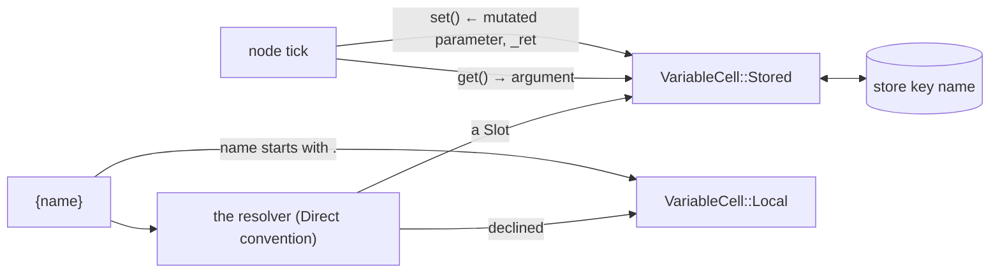

# Nodes, and how the tree runs them

The [readme](../readme.md) introduces the tree: nodes, the three kinds of
function a node calls, variables, and the interpreter. This page details each
in turn: what a node is, the native nodes, how a node calls a module
function, how it reaches the store, detached nodes, and how the interpreter
hosts a behavior and the task runs beside it. It builds on
[how a behavior interpreter works](../../arora-behavior/docs/interpreter-workflow.md),
whose load → tick → edit lifecycle the tree follows.

## What a node is

A tree is a list of [`schema::Node`](../src/schema.rs)s, the first the root:

```rust
pub struct Node {
    pub id: Uuid,
    pub function: Uuid,                          // what the node does
    pub arguments: HashMap<Uuid, Expression>,    // by parameter id
    pub children: Option<Vec<Uuid>>,             // ordered, for a control node
}
```

There is one kind of node, and its `function` id alone says what it does: the
tree runs the function itself when it is a native one, and calls a module
otherwise. The same split holds in the shared
[`Graph`](../../arora-behavior/src/graph.rs) the tree is lowered from, whose
nodes are bound to functions the same way.

An argument is an [`Expression`](../src/schema.rs):

| Expression | Reads | In the shared graph |
|---|---|---|
| `Value`, `Uuid` | a literal | `Source::Value` |
| `VariableId` | a variable, shared by every node naming it | `Source::Key`, the variable of that key |
| `NodeArgument` | another node's argument cell, or its return value (`_ret`) | `Source::Port` |
| `Select` | a part of another expression's value, by a [`Key`](../../arora-types/src/data/state.rs) path | `Source::Select` |
| `Call` | a module function's return value, called each time the node ticks | a detached node read by its return value |

`Variable` holds a cell directly, for trees built in Rust.

### Node status and interpreter status

A node's tick gives a [`Status`](../../arora-behavior/src/status.rs):
`Success`, `Failure` or `Running`. The interpreter's own tick gives a
[`BehaviorStatus`](../../arora-behavior/src/lib.rs), which says whether the
runtime ticks it again: the tree interpreter always answers `Running`, since a
finished tree is ticked again from its root at the next step.

## Native nodes

The tree ticks these itself: no engine round trip, no module to load, and
none of them is in the device's function index. Each has a name in the text
language, a tag in Groot, and a builder in [`nodes`](../src/nodes.rs).

| Text | Groot | Builder | Ticks |
|---|---|---|---|
| `sequence` | `Sequence` | `seq` | each child in turn; stops at the first that does not succeed, with its status. `Success` with no child. |
| `sequence_star` | `SequenceStar` | `seq_star` | as `sequence`, but a `Running` child is resumed at the next tick, past the children that succeeded; its `current_index: u16` holds where. |
| `fallback` | `Fallback` | `fallback` | each child in turn; stops at the first that does not fail, with its status. `Success` with no child. |
| `parallel` | `Parallel` | `parallel` | every child, every tick; `Success` if all succeeded, `Failure` if any failed, `Running` otherwise. |
| `succeed`, `fail`, `running` | `Succeed`, `Fail`, `Run` | `succeed`, `fail`, `run` | their status. |
| `equal` | `Equal` | | `Success` when `a` and `b` are equal (the same type and value: `U64(1)` and `U32(1)` differ, and NaN equals nothing), `Failure` otherwise. |
| `unpack` | `Unpack` | | writes element `i` of the array `values` to the variable bound to `out_i`, `out_0` … `out_63`; `Success`, or `Failure` for a table that does not fit (below). |
| `scatter` | `Scatter` | | writes element `i` of `values` to the store key named by element `i` of `keys`, every key under `within`; `Success`, or `Failure` for a table that does not match (below). |
| `set_string` | `SetString` | `set_str` | `variable` takes `value`; an unset `value` unsets it. `Success`. |
| `unset_string` | `UnsetString` | `unset_str` | `variable` is unset. `Success`. |
| `is_string_set` | `IsStringSet` | `is_str_set` | `Success` if `value` is a non-empty string, `Failure` if it is unset or empty. |
| `wait_string_set` | `WaitStringSet` | `wait_str_set` | `Success` if `value` is a non-empty string, `Running` while it is unset or empty. |
| `regex_match` | `RegexMatch` | `regex_match` | `Success` if the [regular expression](https://docs.rs/regex) `matcher` matches in `value`, writing the whole match to `first_match`; `Failure`, writing nothing, if either is unset, `matcher` is invalid, or nothing matches. |
| `run_call` | `RunCall` | | calls the [`Call`](../../arora-types/src/call.rs) its `call` argument holds, whatever function it names; the call's `Status`, or `Success` for any other return. |
| `run_status` | `RunStatus` | | ticks its one child and writes the child's status to `status`; latches the first terminal status in `latch`, and reports it from then on without ticking the child. A child's error ends it `Failure`. |

`succeed`, `fail` and `running` are leaves, and so are the data, string and
task-run nodes but `run_status`, a decorator. A text or Groot tree leaves out
a native's state (`current_index`, `latch`) and the tree seeds it.

### The string nodes

The string nodes ([`core_nodes`](../src/core_nodes.rs)) share their function
ids, parameter ids, names and semantics with the functions of the
[`test-behavior-tree-nodes`](../../../modules/test-behavior-tree-nodes/readme.md)
module, so a tree naming that module's functions runs them natively.

Like a module function they are value-based: a node never names a store key.
It receives the values its arguments are bound to and writes through its
out-parameters; which keys those are is the tree's business. A variable that
holds nothing (a store key not set yet, an unbound tree-local, `()`) reads as
unset. Writing `Some(s)` writes `s`, creating the key; writing `None` unsets
it; an out-parameter left as it was does not touch the store. A value that is
not a string fails the tick with a conversion error.

So a branch reacts once to each write of a key from outside the tree; the key
is absent at first, which is a failed condition, not an error:

```xml
<Sequence>
  <IsStringSet value="{command}"/>
  <SetString variable="{last_command}" value="{command}"/>
  <UnsetString variable="{command}"/>
</Sequence>
```

### The data nodes

`equal`, `unpack` and `scatter` read their arguments through any expression,
a selection included; each must have its inputs bound.

**`unpack(values, out_0 … out_63)`** writes element `i` of the array `values`
to the variable bound to `out_i`, and succeeds. An unbound port is skipped,
and so is a `()` element, which leaves its variable as it is; elements past
the last bound port are ignored. It fails, writing nothing, when `values` is
not an array or is shorter than the last bound port needs. Each `out_i` is an
ordinary binding, made when the tree is lowered, so which keys a tree writes
is structure: shown in its graph and changed by an edit. Lowering refuses a
port bound to anything but a variable, and two ports bound to one variable.
There are 64 ports because each is declared, one line in the Groot palette
and one row in Groot's port editor: 64 holds a face's 52 ARKit blend shapes
with head and eye pose beside them. A longer array, or keys that come as
data, go to `scatter`.

**`scatter(values, keys, within)`** writes element `i` of the array `values`
to the store key named by element `i` of the array `keys`, and succeeds; a
`()` element leaves its key as it is. The keys are data (the animation
module's `output_keys`, a selection out of a record a module returns), so one
node writes a table of any length in a tick, and a table whose keys change
needs no edit of the tree. `within` is a literal key prefix fixed at
lowering: every key is `within` or under it (`within: "rig"` covers `rig` and
`rig/…`, not `rigs`), so the keys a tree can write are still read off its
graph. An empty or absent `within` is the tree's whole namespace: any key but
a tree-local one; an analysis of the keys a tree writes then counts the node
as writing every key, as it counts a module function's mutable parameter as
written whether or not a call writes it. Lowering refuses a `within` that is
not a literal string, ends with `/`, or starts with `.`.

A `scatter` tick checks every key before it writes any:

- it fails, writing nothing, when `values` or `keys` is not an array, a key
  is not a string, or the two arrays differ in length: a table whose keys
  and values do not match yet, which a guard can wait out;
- it errors, writing nothing, when a key starts with `.`, is outside
  `within`, or is named twice: a tree-local name is no store key, and the
  tree would otherwise write a key its graph does not name, or one key twice
  in a tick.

The failures are checked first, so a table that does not match yet fails
whatever its keys name. The node keeps the `Slot`s its keys resolved to,
and resolves them again only when `keys` changes. As for every write, a value
that does not move makes no store change.

In Groot: `<Equal a="…" b="…"/>`,
`<Unpack values="{.values}" out_0="{face/k0}" out_2="{face/k2}"/>` (an unbound
port left out), and `<Scatter values="{.values}" keys="{.keys}" within="rig"/>`.

### The task-run nodes

`run_call` and `run_status` are what the interpreter builds a task run from
(see [the interpreter](#the-interpreter)): a `run_status` decorator over a
`run_call` leaf, or over the root of a spawned graph. The `Call` travels as
a literal argument, so a run is data in the graph like any other node. In
Groot: `<RunCall call="json:…"/>` and
`<RunStatus status="{key}">…</RunStatus>`.

## How a node calls a module function

```mermaid
flowchart TB
  tick["node tick"] --> pull["bring the detached nodes it reads up to date"]
  pull --> native{"native function?"}
  native -- yes --> builtin["tick it natively<br/>(control nodes tick their children<br/>through their registered ticks)"]
  native -- no --> found{"in the function index?"}
  found -- no --> notfound(["error: FunctionNotFound"])
  found -- yes --> call["build a Call: module id, function id,<br/>children as TickId[], each argument"]
  call --> bridge["call_bridge.arora_call(call)"]
  bridge --> back["write back mutated parameters<br/>and _ret"]
  back --> status(["Status: the return value if a Status,<br/>Success otherwise"])
  builtin --> status2(["Status"])
```

A node whose function is not native ([`tick`](../src/behavior_tree.rs)):

1. finds its function in the function index the tree was lowered with: a
   [`ModuleFunction`](../../arora-behavior/src/lib.rs) with the module id and
   the frozen signature;
2. builds a [`Call`](../../arora-types/src/call.rs) with the module id and
   the function id;
3. for a node with children, checks that the function's first parameter is
   `children`, an array of `arora.TickId`, and passes the callable each child
   is registered as; the function ticks a child through indirect dispatch, and
   reads its `Status`;
4. passes each argument, in the function's parameter order: a call in an
   argument is called first, a selection is read out of its source, and any
   other argument is read from its cell;
5. calls `arora_call` on the [`CallBridge`](../../arora-types/src/call.rs);
6. writes each parameter the function reports mutated back to the cell its
   argument reads (a selection is read-only: the interpreter refuses one on a
   mutable parameter);
7. reports the return value when it is a `Status`. A node binding `_ret`
   ([`_RET_PARAM_ID`](../src/schema.rs)) writes the return value to that
   variable and reports `Success`, and any other return value reports
   `Success` too.

Every node the tree holds, native or not, is registered on the bridge as a
callable when the tree is lowered, and its tick is that callable: a native
control node ticks its children through the bridge as a module's control
node does.

A parameter the node gives no argument is not in the call. A module declared
with [`arora-module`](../../arora-module/readme.md) reads such a parameter as
`None` when it is optional, and refuses the call otherwise.

## How a node reaches the store

A node never touches the `DataStore`. Each argument is bound, when the tree is
lowered, to a [`VariableCell`](../src/variable.rs):

```rust
pub enum VariableCell {
    Local(Rc<RefCell<Option<Value>>>),  // a cell of the tree
    Stored(Rc<dyn Slot>),               // a handle on one store key
}
```

A `Stored` cell wraps a [`Slot`](../../arora-types/src/data/store.rs): a
handle on one key, resolved once, so a tick reads and writes the key without
resolving its path. Which a variable `{name}` becomes is decided at lowering,
by the **Direct convention**: the name is the store key. The interpreter's
resolver gives the `Slot` of the key `name`; a tree lowered with no resolver, or
one that declines the name, gets a tree-local cell.

**Tree-local variables.** A variable whose name starts with `.`, `{.values}`,
never reaches the resolver: it is a cell of the tree, which makes no store
change and no bridge sees, and no analysis of the keys a tree writes counts
it. Two trees' `{.x}` never meet; the interpreter lowers its main behavior
and its task runs into one tree, so they share one. A `.` variable carries a
value between nodes of one tree, such as a module's array output on its way
to `unpack`; a value another tree reads goes through a store key. A variable with no name is
tree-local too, and Groot export writes it as `.` and its id.



A read is a node filling an argument from its cell; a write is the tick
setting the cell, when a module reports a mutated parameter, when a node
binds `_ret`, or when a native node writes. A write that does not change the
value makes no store change, so nothing reaches a bridge.

A variable may hold nothing, such as a key not set yet. What a module function
then receives depends on its parameter's type
([`argument_value`, `write_back`](../src/behavior_tree.rs)):

- an **optional** parameter receives `None`, and a present value as
  `Some(value)`: the function decides what absence means;
- any other parameter receives `()`, which the function refuses unless it
  takes it;
- an optional **out-parameter**, or an optional return bound to `_ret`, maps
  onto the key's presence: `Some(v)` writes `v`, creating the key; `None`
  unsets it.

`scatter` is the one node that names store keys while it ticks: its keys are
data, so they cannot be bound at lowering. It resolves them through the
resolver the tree was given with `BehaviorTree::with_key_resolver`; the
interpreter gives its trees the Direct convention's, over its own handle on
the store. A tree built without one runs, and its `scatter` nodes error when
they write.

## Detached nodes

A node is **attached** when the tree holds it: it is the root, or a child of
an attached node. A call to a module function that no node holds, and that
holds no children, is **detached** ([`detached`](../src/detached.rs)). Both
are the same `Node`; attachment decides only when it runs. An attached node
runs when its parent ticks it. A detached node runs when what it outputs is
about to be read:

- **before its reader**: a node brings up to date the detached nodes it
  reads, through `@node._ret` or `@node.parameter`, or through the tree-local
  variable a detached node's output is bound to;
- **once per tick**: the first read of a tick brings it up to date, and later
  reads of the tick reuse that result;
- **only when its inputs changed**: it calls its function only when its
  argument values differ from those of its last call, so a settled graph
  makes no calls, and a value that changes at every tick, such as
  `arora/time`, calls the nodes reading it at every tick;
- **with its state in a mutable parameter**: a literal argument to one is the
  node's own cell, which starts from the literal and keeps what the function
  writes back.

A detached node with an output bound to a store key is a **sink**. Its
readers are outside the tree, so it is brought up to date at every tick,
after the tree has ticked, even when the tree failed. Once every sink is up
to date, each publishes its keys, in the order the tree lists them (by id,
for a tree lowered from the shared graph): a sink never reads another's key
of the same tick, and of two sinks of one key, the later wins. A detached
node that nothing reads and that writes no key never runs. A store key is
read as the store holds it, so a value fed back through a key, or passed from
one graph to another, reaches its reader at the next tick.
[`DetachedPlan`](../src/detached.rs) (`BehaviorTree::detached_plan`) lists
which detached nodes run at every tick, which on demand, and which never.

A function with an effect its arguments do not show, such as the animation
module's `step_values`, which advances its players by the time it is given,
belongs in the tree as an attached leaf, ticked at every tick: a detached
call runs only when it is read, and only for arguments it has not seen.

## The interpreter

[`BehaviorTreeInterpreter`](../src/behavior.rs) implements
[`BehaviorInterpreter`](../../arora-behavior/src/lib.rs):

| Interpreter call | The tree |
|---|---|
| `load(graph)` | replaces the main behavior with `graph`, the runner's first child; `load_groot` reads Groot XML into a graph first |
| `apply(diff)` | edits the graph; `set_root` names the main behavior's new root |
| `spawn(call, policy)` | starts a task run: a `run_status` decorator over a `run_call` leaf holding `call` |
| `spawn_graph(type, graph, policy)` | starts a task run of a `behavior-tree` graph: the decorator over the graph's root, its detached nodes beside it; a graph whose root a live run has replaces that run's program |
| `halt(task)` | removes the run's nodes; its status, `Failure`, is written at the next tick |
| `tick(context)` | re-lowers the graph if it changed, ticks the runner once, and reports `Running` |

The graphs and diffs these take are by ids; a file naming its references is
resolved first ([which form to use](text.md#which-form-to-use)).

**The runner scaffold.** The interpreter hosts one graph, rooted at a
`parallel` runner created with it. The main behavior is the runner's first
child, then each live run's decorator in the order the runs were spawned. A
run is the subtree under its decorator; its decorator publishes the run's
status to the key its `TaskHandle` names, under `arora/tasks/`. An edit
reaches a run's nodes by id like any other node's, but cannot change a
decorator or remove a run's root: halting is how a run leaves. Every policy
runs concurrently, as the parallel runner does.

**Ticks.** One runtime step is one tick of the runner. The main behavior is
ticked again from its root after it finishes; a run latches its terminal
status and leaves the graph at the next tick. A run whose program errors
ends `Failure`: the error is the tick's, once, and the other runs tick on.
Time is no tick argument: the runtime writes the step's clock to the store
before the tick, as `arora/time` and `arora/dt` (nanoseconds, `U64`;
[`built_in`](../../arora-behavior/src/built_in.rs)), and a node reads them as
any key.

**Edits keep state.** The graph is lowered again only when it changed, and
the new lowering takes over the state of every node the change left in place
([`BehaviorTree::keep_state`](../src/behavior_tree.rs)): a `sequence_star`'s
index, a run's latch, a call site's cell, and the tree-local variables such a
node reads. A node the change sets, or whose bindings it changes, starts
afresh, and so does a tree-local variable only such nodes read. A graph that
does not lower leaves the previous lowering in place, unticked, and the error
is the tick's.

**Lowering** ([`graph`](../src/graph.rs)) turns each node's bindings into
its argument expressions: a port bound to a key, whether the function reads
it or writes it, takes the variable that key names. A `BehaviorTree` built without a graph runs
on its own (see the [readme](../readme.md#without-the-interpreter)), but has
no graph to edit.

## Source map

| Concept | File |
|---|---|
| The interpreter, the runner scaffold, task runs | [`src/behavior.rs`](../src/behavior.rs) |
| The runtime tree, native and module dispatch, loading | [`src/behavior_tree.rs`](../src/behavior_tree.rs) |
| `Node`, `Expression`, `_RET_PARAM_ID` | [`src/schema.rs`](../src/schema.rs) |
| Native node ids and builders | [`src/nodes.rs`](../src/nodes.rs) |
| The string nodes | [`src/core_nodes.rs`](../src/core_nodes.rs) |
| `scatter`'s keys | [`src/scatter.rs`](../src/scatter.rs) |
| Detached nodes | [`src/detached.rs`](../src/detached.rs) |
| `VariableCell`, the resolver | [`src/variable.rs`](../src/variable.rs) |
| Lowering the shared graph | [`src/graph.rs`](../src/graph.rs) |
| Groot XML | [`src/schema_groot.rs`](../src/schema_groot.rs) |
| The text language, and the display that writes it | [`src/text/`](../src/text/mod.rs), [`src/display.rs`](../src/display.rs) |
| `Status` | [`arora-behavior/src/status.rs`](../../arora-behavior/src/status.rs) |
