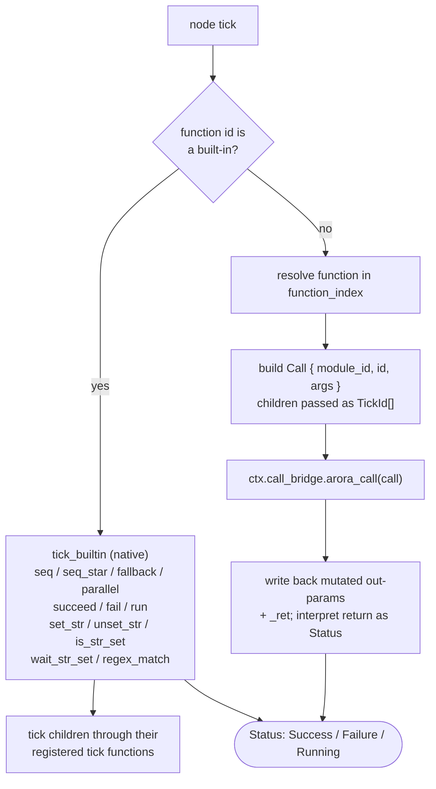
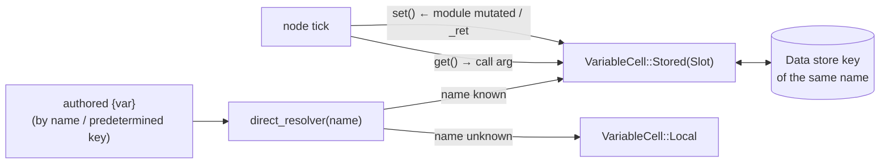

# Behavior-tree nodes — a concrete interpreter

This crate is one concrete implementation of the Arora behavior-interpreter contract. Read **[how a behavior interpreter works](../../arora-behavior/docs/interpreter-workflow.md)** first — this page assumes the load → tick → graph-update lifecycle described there and only covers what is *specific* to the behavior tree: what a node is, how a node ticks, and how nodes reach the data store and the engine's modules.

The interpreter type is [`BehaviorTreeInterpreter`](../src/behavior.rs#L35-L46). It implements [`BehaviorInterpreter`](../../arora-behavior/src/lib.rs#L93-L130): `tick` re-lowers the graph if dirty then runs the tree to a terminal status ([`behavior.rs:119-151`](../src/behavior.rs#L119-L151)); `apply(GraphDiff)` mutates its held graph and marks it dirty ([`behavior.rs:153-170`](../src/behavior.rs#L153-L170)); `load` replaces the whole behavior ([`behavior.rs:172-179`](../src/behavior.rs#L172-L179)). It maps onto the shared lifecycle like this:

| Interpreter lifecycle | Behavior tree |
|---|---|
| load | `load` / `load_graph` / `load_groot`, or first `apply` onto an empty graph ([`behavior.rs:72-110`](../src/behavior.rs#L72-L110)) |
| time update | no hook — nodes read the built-in `arora/dt` from the store like any slot |
| tick | run-once-per-tick: re-lower if dirty, then run the tree to `Success`/`Failure`; idle → `Running` ([`behavior.rs:119-151`](../src/behavior.rs#L119-L151)) |
| graph update | `apply(GraphDiff)` sets `dirty`; the next tick re-lowers against the live store ([`behavior.rs:123-139`](../src/behavior.rs#L123-L139)) |

## What a node is

A tree node is **a `function` UUID + argument expressions + optional child ids** ([`schema::Node`, `schema.rs:21-39`](../src/schema.rs#L21-L39)):

```rust
pub struct Node {
    pub id: Uuid,
    pub function: Uuid,                          // what this node does
    pub arguments: HashMap<Uuid, Expression>,   // its inputs
    pub children: Option<Vec<Uuid>>,            // ordered children, if any
}
```

There is **one node kind**; the `function` id is the sole discriminant. The runtime either handles that id **natively** (a core node: a control node or a string node) or **dispatches it as a module call** — the same homogeneous split the shared graph model describes ([`arora-behavior/src/graph.rs:5-9`](../../arora-behavior/src/graph.rs#L5-L9)). Arguments are [`Expression`s](../src/schema.rs#L48-L64): a literal `Value`, a blackboard variable id (`{var}` shared across nodes), another node's argument slot, or a nested `Call` evaluated every tick.

### Node tick status vs. interpreter status

A node's tick returns a three-state [`Status`](../src/arora_generated/behavior_tree/status.rs#L5-L10) — `Success | Failure | Running`. This is distinct from the interpreter-level [`BehaviorStatus`](../../arora-behavior/src/lib.rs#L47-L53) (`Running | Done`): a whole tree runs to a terminal `Success`/`Failure` each interpreter tick, so `BehaviorTreeInterpreter::tick` reports `Done` ([`behavior.rs:145-150`](../src/behavior.rs#L145-L150)); an empty interpreter idles as `Running`.

This is the sharpest contrast with Vizij's node graph, whose nodes are dataflow (they produce values, not a Success/Failure/Running status) and whose interpreter runs forever (`Running`) — see [the parallels in the NodeGraph doc](https://github.com/vizij-ai/vizij-rs/blob/main/crates/interop/vizij-arora-behavior/docs/node-graph.md).

### Core nodes

The core nodes are wired into this crate and dispatched natively (no engine round-trip, no module to load, not in the function index): every tree — every device — has them. They are the control nodes and status leaves, and the string nodes.

#### Control nodes

Groot `Sequence`, `SequenceStar`, `Fallback`, `Parallel`, and the leaves `Succeed`, `Fail`, `Run`. Builders in [`nodes.rs`](../src/nodes.rs): `seq` ([`:119`](../src/nodes.rs#L119)), `seq_star` ([`:124`](../src/nodes.rs#L124), resumes past already-succeeded children via a persisted index), `fallback` ([`:136`](../src/nodes.rs#L136)), `parallel` ([`:141`](../src/nodes.rs#L141)), and the leaves `succeed`/`fail`/`run` ([`:13-23`](../src/nodes.rs#L13-L23)).

#### Core string nodes

Groot `SetString`, `UnsetString`, `IsStringSet`, `WaitStringSet`, `RegexMatch`, implemented in [`core_nodes.rs`](../src/core_nodes.rs) (builders `set_str`, `unset_str`, `is_str_set`, `wait_str_set`, `regex_match` in [`nodes.rs`](../src/nodes.rs#L39-L90)). They were first the test module `test-behavior-tree-nodes`'s functions and keep its function ids, parameter ids, attribute names and semantics, so trees written against the module mean the same.

Like any module function they are **value-based**: a node never names a store key. It receives the values its ports are bound to and writes through its out-parameters; which keys those are is the tree's business (its `{var}` bindings). A port bound to a variable that holds nothing — a store key that is not set (yet), an unbound local, `()` — reads as `None`. An out-parameter set to `Some(s)` writes `s`, creating the key if it did not exist; set to `None`, it unsets the key; left as it was, the store is not touched. A port bound to a value that is not a string (or an optional string) fails the tick with a conversion error, as the module's argument decoding did.

| Groot node | Signature | Status |
|---|---|---|
| `SetString variable="{key}" value="…"` | `set_str(variable: &mut Option<String>, value: Option<String>)` | `variable` takes `value` (an unset `value` unsets `variable`); `Success`. |
| `UnsetString variable="{key}"` | `unset_str(variable: &mut Option<String>)` | `variable` is unset; `Success`. |
| `IsStringSet value="{key}"` | `is_str_set(value: Option<String>)` | `Success` if `value` is a **non-empty** string; `Failure` if it is unset or `""`. |
| `WaitStringSet value="{key}"` | `wait_str_set(value: Option<String>)` | `Success` if `value` is a non-empty string; `Running` while it is unset or `""`. |
| `RegexMatch value="…" matcher="…" first_match="{key}"` | `regex_match(value: Option<String>, matcher: Option<String>, first_match: &mut Option<String>)` | `Success` if the regular expression `matcher` ([`regex`](https://docs.rs/regex) syntax) matches in `value`, writing the matched text (the whole match, not a capture group) to `first_match`. `Failure`, leaving `first_match` alone, if `value` or `matcher` is unset, `matcher` is invalid, or nothing matches. |

So a branch can react once to each write of a key from outside the tree — the key is absent at first, which is a failed condition, not an error:

```xml
<Sequence>
  <IsStringSet value="{command}"/>
  <SetString variable="{last_command}" value="{command}"/>
  <UnsetString variable="{command}"/>
</Sequence>
```

The other palette tags (`Status`, `Store`, `Increase`, `Cos`) stay the test module's: a tree using them needs that module loaded.

Two data nodes are ticked natively too, and read their arguments through any link source, a selection included:

- **`Equal(a, b)`** succeeds when its two values are equal and fails otherwise — a condition over data.
- **`Unpack(values, out_0 … out_63)`** writes element `i` of the array `values` to the variable bound to its output port `out_i`, and succeeds. An unbound port is skipped, and so is a `Unit` element; elements past the last bound port are ignored. It fails, writing nothing, when `values` is not an array or is shorter than the last bound port needs. Each `out_i` is an ordinary port binding (`out_0="{face/k0}"`), bound when the tree is lowered as any port is, so which keys a tree writes is structure: shown in the graph and changed by an edit. Lowering refuses a port bound to anything but a variable, and two ports bound to one variable or one name. The node has 64 output ports because each is declared, one line in the Groot palette and one row in Groot's port editor: 64 holds a face's 52 ARKit blend shapes with head and eye pose beside them, and a longer array is split by its producer.

They are part of the `behavior-tree 1.1` format. In Groot they are `<Equal a="…" b="…"/>` and `<Unpack values="…" out_0="{face/k0}" out_2="{face/k2}"/>`, an unbound output left out: a port holds `{name}` for a variable, `json:` and a value's serde form for a typed literal (`json:{"u64":1}`), or plain text for a string; export falls back to `json:` wherever plain text would not read back as the same value. The task-run nodes are `<RunCall call="json:…"/>` and `<RunStatus status="{key}">…</RunStatus>`.

## How a node ticks



Native dispatch is [`tick_builtin`](../src/behavior_tree.rs#L241-L423): `SEQ` short-circuits on the first non-`Success` child; `FALLBACK` on the first non-`Failure`; `PARALLEL` ticks every child and succeeds only if all did; `SEQ_STAR` resumes from a persisted `current_index`; the string nodes go to [`tick_core_node`](../src/core_nodes.rs#L132). Any non-built-in function is resolved in the `function_index` and dispatched through the engine ([`behavior_tree.rs:271-436`](../src/behavior_tree.rs#L271-L436)). At setup, **every node is registered on the engine as a callable** and wrapped in a `TickId`, so children can be invoked through the call bridge ([`setup_tick_function`, `behavior_tree.rs:104-152`](../src/behavior_tree.rs#L104-L152)).

## How nodes interact with the data store

A node never touches `DataStore` directly. Its arguments are bound at build time to **[`VariableCell`s](../src/variable.rs#L16-L23)**, and a cell is the whole store-interaction surface:

```rust
pub enum VariableCell {
    Local(Rc<RefCell<Option<Value>>>),   // tree-local scratch, no store backing
    Stored(Rc<dyn Slot>),                // a handle into the host data store
}
```

A `Stored` cell wraps a [`Slot`](../../arora-types/src/data/store.rs#L49-L54) — a direct handle to one store key's cell, resolved once so `get`/`set` skip re-resolving the path each tick. Which one a `{var}` becomes is decided when the tree is lowered, by the **Direct convention** (the variable's name *is* the store key): [`direct_resolver`](../src/behavior.rs#L48-L52) hands back `store.slot(&Key::from(name))`, and the first reference to a variable binds it to that store slot if the resolver knows the name, else a tree-local cell ([`behavior_tree.rs:611-630`](../src/behavior_tree.rs#L611-L630)).



So a **read** is a node filling a call argument from its variable, and a **write** is the tick calling `variable.set(...)` when a module reports a mutated parameter or a `_ret` return ([`behavior_tree.rs:401-431`](../src/behavior_tree.rs#L401-L431)). Because a store-backed cell's `set` goes straight to the `Slot`, a node's output lands in the store key of the same name. Verified by [`resolved_variable_is_store_backed`](../src/tests.rs#L93-L144).

A variable may hold nothing — a store key that is not set yet. What a module function then receives depends on its parameter's declared type ([`argument_value`](../src/behavior_tree.rs#L606), [`write_back`](../src/behavior_tree.rs#L620)):

- an **optional** parameter (`Option<T>`) receives `None`, and a present value as `Some(value)` — the function decides what absence means;
- any other parameter receives `()`, which the function refuses unless it takes it (an unset key is an error there);
- an optional **out-parameter**, or an optional return bound with `_ret`, maps onto the key's presence: `Some(v)` writes `v` (creating the key), `None` unsets it.

## How nodes interact with modules

A node whose function id is not a built-in is dispatched into the engine ([`behavior_tree.rs:271-436`](../src/behavior_tree.rs#L271-L436)):

1. **Resolve** the function in the `function_index` → a `ModuleFunction { module_id, function_id, … }` ([`behavior_tree.rs:289-295`](../src/behavior_tree.rs#L289-L295)).
2. **Build a `Call`** carrying the module id and the node's function id ([`behavior_tree.rs:297-303`](../src/behavior_tree.rs#L297-L303)).
3. **Pass children as `TickId`s** — a node with children requires its function's first parameter to be a `children` array of `TickId`; each child's registered `callable_id` is packed in, which is how a control-flow *module* re-enters the tree ([`behavior_tree.rs:312-365`](../src/behavior_tree.rs#L312-L365)).
4. **Resolve remaining args** from the node's variable cells ([`behavior_tree.rs:371-405`](../src/behavior_tree.rs#L371-L405)).
5. **Invoke** `ctx.call_bridge.arora_call(call)` ([`behavior_tree.rs:408-410`](../src/behavior_tree.rs#L408-L410)).
6. **Write back** each mutated out-parameter into its variable ([`behavior_tree.rs:412-422`](../src/behavior_tree.rs#L412-L422)).
7. **Interpret the result**: a node that bound the special `_ret` parameter captures the return value into a variable and reports `Success`; otherwise the module's return value is read as a `Status` ([`behavior_tree.rs:426-435`](../src/behavior_tree.rs#L426-L435)).

This is the tree's version of what the shared model calls a module call. (The `GraphHost`/`ModuleCall` vocabulary belongs to Vizij's node-graph interpreter; here the mechanism is function-id-routed `arora_call` dispatch.) The engine module surface is the same `CallBridge` an interpreter receives in its `BehaviorContext`.

## Editing a running tree

`apply(GraphDiff)` mutates the retained [`Graph`](../../arora-behavior/src/graph.rs#L146-L162) and sets `dirty`; the next `tick` re-lowers via `build_behavior_tree(graph, &direct_resolver(ctx.store))` ([`behavior.rs:123-139`](../src/behavior.rs#L123-L139)). Lowering ([`graph.rs`](../src/graph.rs)) turns the shared model's links into node argument expressions and binds predetermined, unlinked slots to the store variable named by their key ([`graph.rs:74-103`](../src/graph.rs#L74-L103)). A raw `BehaviorTree` loaded with `load` (no authored graph) ticks fine but rejects `apply` ([`behavior.rs:160-164`](../src/behavior.rs#L160-L164)). The end-to-end "build a graph, run it, edit it via a diff, re-run" example is [`seq_of_builtins_lowers_and_runs`](../src/graph.rs#L219-L242).

## Source map

| Concept | File |
|---|---|
| The interpreter (`tick`/`apply`/`load`) | [`crates/arora-behavior-tree/src/behavior.rs`](../src/behavior.rs) |
| Runtime tree, native dispatch, module dispatch, `TickId` | [`crates/arora-behavior-tree/src/behavior_tree.rs`](../src/behavior_tree.rs) |
| Node/`Expression` schema | [`crates/arora-behavior-tree/src/schema.rs`](../src/schema.rs) |
| Core node ids and builders | [`crates/arora-behavior-tree/src/nodes.rs`](../src/nodes.rs) |
| Core string nodes (functions, signatures, native tick) | [`crates/arora-behavior-tree/src/core_nodes.rs`](../src/core_nodes.rs) |
| `VariableCell` (store binding) | [`crates/arora-behavior-tree/src/variable.rs`](../src/variable.rs) |
| Lowering the shared `Graph` → runnable tree | [`crates/arora-behavior-tree/src/graph.rs`](../src/graph.rs) |
| `Status` enum | [`crates/arora-behavior-tree/src/arora_generated/behavior_tree/status.rs`](../src/arora_generated/behavior_tree/status.rs) |
| The interpreter contract this satisfies | [`arora-behavior/docs/interpreter-workflow.md`](../../arora-behavior/docs/interpreter-workflow.md) |

Tests: core string nodes in Groot trees over a store and optional parameters bound to unset keys (`core_string_nodes`, `optional_parameters` in [`tests.rs`](../src/tests.rs)), native control-node semantics ([`tests.rs:267-409`](../src/tests.rs#L267-L409)), store round-trip ([`tests.rs:93-144`](../src/tests.rs#L93-L144)), fresh-interpreter edit + idle ([`tests.rs:411-438`](../src/tests.rs#L411-L438)), graph lower/edit/run and predetermined keys ([`graph.rs:219-420`](../src/graph.rs#L219-L420)).
