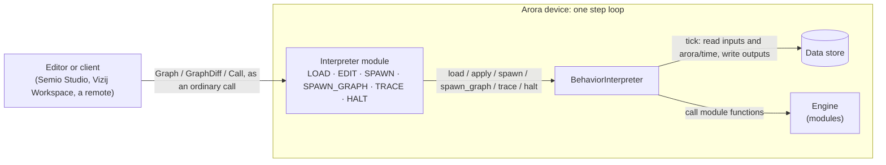
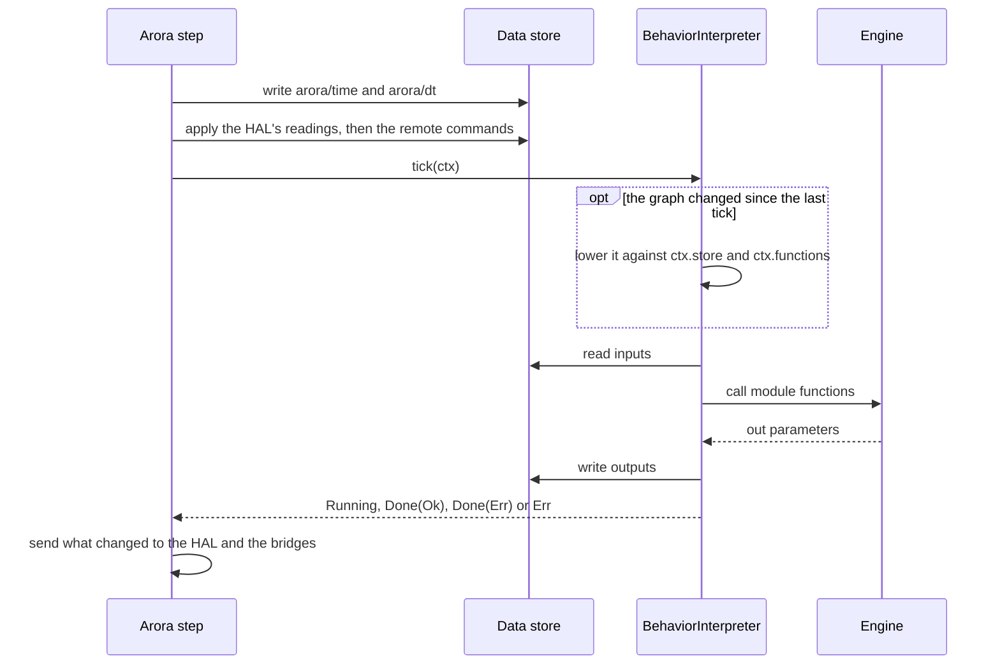

# How a behavior interpreter works

This page follows a behavior interpreter through its life in a device: how it
is installed, how a behavior is loaded into it, how the runtime ticks it, how
the running behavior is edited, how it hosts task runs, and how it ends. It
assumes the [crate readme](../readme.md). The step that ticks the interpreter
is in [`arora`'s runtime page](../../arora/docs/runtime-and-data-flow.md).

## The pieces

A **behavior** is data: a `Graph` ([`graph`](../src/graph.rs)). An
**interpreter** lowers it into its own runnable form and walks that form each
tick. The graph model knows nothing of ticking: the behavior tree reads a
node's bindings as its arguments and its children as the tree; a node graph
reads the bindings as dataflow.

## The trait

[`BehaviorInterpreter`](../src/lib.rs) has one required method; the others
default to refusing, so an interpreter implements what it supports.

| method | the runtime calls it | default |
|---|---|---|
| `tick(&mut BehaviorContext)` | once per step | required |
| `load(Graph)` | on the interpreter module's `LOAD` | refuses |
| `apply(GraphDiff)` | on `EDIT` | refuses |
| `read()` | on `READ` | refuses |
| `spawn(Call, RunPolicy)` | on `SPAWN` | refuses |
| `spawn_graph(&GraphType, Graph, RunPolicy)` | on `SPAWN_GRAPH` | refuses |
| `trace(TraceOptions)` | on `TRACE` | refuses |
| `halt(TaskId)` | on `HALT` | refuses |
| `described_methods()` | once, when the device is built | describes none |

Each tick receives a `BehaviorContext`:

| field | what it is |
|---|---|
| `store: &dyn DataStore` | the device's data store: read inputs, write outputs |
| `call_bridge: &mut dyn CallBridge` | the engine, to call module functions |
| `functions: &FunctionIndex` | the device's method index: every described function, with its module and signature |

The store is shared by reference yet written through it: a `DataStore` takes
`&self` for reads and writes alike.

The trait is not `Send`. A device is stepped on one thread, and the
interpreter is shared between the step and the interpreter module through a
`RefCell`, not a lock.

## 1. Installed once

A device holds one interpreter, given at build
(`AroraBuilder::with_behavior_interpreter`) and never swapped. With none
given, the device builds an empty `BehaviorTreeInterpreter`. An interpreter
starts empty and ready: with no behavior loaded, the behavior tree ticks as
`Running` and does nothing. The device asks for its `described_methods`
once, at build.

## 2. Load

A behavior arrives as a whole `Graph`:

| `Graph` field | what it holds |
|---|---|
| `root` | the entry node, for a tree-shaped interpreter |
| `nodes` | the `Node`s, a list with unique ids: each bound to a `function` (a function id the interpreter runs natively, or a module function), with its `bind`ings and, for a tree, its ordered `children` |

A node's `bind` maps each port it binds to a `Source`: a literal `Value`, a
store `Key` by its path (one starting with `.` is the interpreter's own),
another node's `Port`, or a `Select`ion into one of those. An input's binding
feeds it; an output's is where it is written. Which ports a function reads
and writes, and their types, is its signature's to say: the graph holds the
bindings alone. The order of the nodes is the order they serialize in, and
means nothing to an interpreter.

A graph or diff an interpreter takes names its nodes, functions and ports by
id. A file a person writes or reviews names them instead, and is resolved to
ids before it is sent: a name means what the device's functions make it
mean, which changes as modules come and go. arora-behavior-tree's
[`readable`](../../arora-behavior-tree/src/readable.rs) reads and writes such
files, and its [`text.md`](../../arora-behavior-tree/docs/text.md#which-form-to-use)
says which form to use where.

`load` replaces the running behavior with the graph. Loading is the same as
applying, onto an empty graph, the diff from it to the graph
(`Graph::empty().diff(&graph)`).

`load` and `apply` receive no store. An interpreter may validate and keep the
new graph, then lower it at its next tick, which carries the store. That is
what makes both callable from the interpreter module, which holds no store.
The behavior tree does exactly that: it marks itself changed, and its next
tick lowers the graph against the store and the method index.

A client loads a behavior through the interpreter module: a `Call` built by
`interpreter_module::encode_load`, sent over a bridge, through a
`LocalCaller` or with `Arora::call`. The `arora` runtime's
`Arora::load_groot` lowers a Groot tree against the method index and sends
the same call.

## 3. Tick

The runtime ticks the interpreter last in the step, after the clock, the
HAL's readings and the remote commands are in the store: the behavior reads
everything that happened in the step, and its writes win the step.

A module function never writes a key. A call takes in parameters and returns
out parameters; the interpreter decides which keys the outputs go to: the
keys the graph binds them to. The store is the whole relationship
between the runtime and the behavior: there is no separate time update, no
input argument and no output return.

**Time is data.** Before anything else in the step, the runtime writes two
built-in keys ([`built_in`](../src/built_in.rs)):

| key | value |
|---|---|
| `arora/time` (`built_in::TIME`) | `U64` nanoseconds on the device's timeline, from its start time, zero unless set |
| `arora/dt` (`built_in::DT`) | `U64` nanoseconds since the previous step |

An interpreter that answers `read` writes a third, `arora/behavior/revision`
(`built_in::BEHAVIOR_REVISION`), at the tick after the behavior changes.

An interpreter that needs time reads them like any other key. The `arora/`
namespace belongs to the runtime and its interpreter; a behavior writes no
key of its own there.

How an interpreter uses the store is its own: the behavior tree binds its
variables to keys by name, once, as direct handles (`Slot`); a node graph
reads and writes keys as dataflow. [arora-behavior-tree's
nodes](../../arora-behavior-tree/docs/nodes.md) are a worked example.

## 4. Edit

A running behavior is edited with a `GraphDiff`, applied in a fixed order so
one diff can remove and rebuild a region at once, coarse to fine
(`Graph::apply`):

| `GraphDiff` field | effect |
|---|---|
| `remove` | remove these nodes, and the bindings reading them; removing the root unroots the graph |
| `set` | set these nodes whole, replacing any with the same id in its place, the others after the graph's nodes |
| `unbind` | unbind these ports |
| `bind` | bind these ports (`Binding { node, port, source }`), replacing what each was bound to |
| `root` | make this node the root |

A diff that binds a port on no node is refused whole. `Graph::diff` gives the
minimal diff between two graphs: a node whose function or children change is
set whole, a node whose bindings alone change gets one entry per binding. An
editor that keeps the graph it last sent sends `EDIT` with the diff to the
next one rather than a `LOAD`.

The diff arrives through the interpreter module's `EDIT`
(`interpreter_module::encode_edit`). Interpreters differ in when they act on
it: the behavior tree keeps the edited graph and re-lowers at its next tick,
restarting the nodes the diff sets or rebinds and keeping the state of every
other; Vizij's node-graph
interpreter
([vizij-rs](https://github.com/vizij-ai/vizij-rs/blob/main/crates/interop/vizij-arora-behavior/docs/node-graph.md))
applies the diff and re-lowers at once, refusing an edit that leaves an
invalid graph.

**Reading it back.** `READ` (`interpreter_module::encode_read`) answers the
main behavior as a `LoadedBehavior`: the graph a `LOAD` of it reproduces,
with no node of the interpreter's own or of a task run, and its revision,
which each load and each edit of the main behavior advances. The interpreter
writes the revision to `arora/behavior/revision`
(`built_in::BEHAVIOR_REVISION`) at the tick after each change, and its traces
report it: an editor that attaches to a device reads the behavior once, then
follows the revision to learn that another client changed it
([reading the behavior](../readme.md#reading-the-behavior)).

A call to the interpreter module from inside the interpreter's own tick — a
behavior editing itself — fails cleanly ("the behavior is being ticked; call
between steps"): the step holds the interpreter for the length of the tick.

## 5. Task runs

A task run is a behavior the interpreter hosts beside the main one, ticked
with it each step:

- `spawn(call, policy)` starts a run from one module `Call`;
- `spawn_graph(graph_type, graph, policy)` starts a run whose program is a
  `Graph`. The interpreter refuses a `GraphType` it does not read
  (`GraphType::reads`: the same language and major version, a minor version
  no newer than its own). A run is known by its graph's root: spawning a graph
  whose root a live run has answers that run's handle, and the run takes the
  graph as its program. The run's nodes are part of the interpreter's graph,
  so `apply` reaches them and a `load` of the main behavior leaves them;
- `halt(task)` stops a run, cleanly; halting a finished or unknown run does
  nothing.

Both spawns answer at once with a `TaskHandle`: the run's `TaskId`, the
`stop` call that halts it, and its keys — `status`, `feedback`, `result`, and
`update` for steering it. The run writes a `Status` to its status key:
`Running`, then `Success` or `Failure`; a halted run ends `Failure`. The
behavior tree allocates a run's keys under
`arora/tasks/<module>/<function>/<run>/`.

`RunPolicy::Concurrent` is the one policy: runs proceed side by side, and
overlapping writes to one key are last-write-wins.

The interpreter module carries each spawn and halt
(`interpreter_module::encode_spawn`, `encode_spawn_graph`, `encode_halt`, and
`decode_spawn_result` for the handle), so a remote starts and stops runs with
ordinary calls. The `arora` runtime follows each run it started, logs when it
starts and ends, and halts the runs calling a module that is reloaded or
unloaded.

`trace(options)` starts a task run of another kind: a trace, which reports
what each tick does on its feedback key until it is halted
([`trace.md`](trace.md)). It answers a `TaskHandle` laid out as a spawn's,
under the interpreter module's `TRACE` function, and the device follows and
logs it like a run.

Methods the interpreter implements itself (`described_methods`) join the
device's method index under `interpreter_module::ID`; a client spawns one
like any task run, and a direct call to it fails.

## 6. Keeps ticking, or ends

After each tick the runtime reads the result:

| `tick` returns | the runtime |
|---|---|
| `Ok(Running)` | ticks it again next step, and clears any standing error |
| `Ok(Done(Ok(())))` | drops it: the device ticks nothing afterwards |
| `Ok(Done(Err(e)))` | raises `e` and drops it |
| `Err(e)` | raises `e` and ticks it again next step |

`BehaviorStatus` is the interpreter's scheduling status, not a behavior's
outcome: a behavior's outcome is a value on a key, and one tick can drive many
task runs. The behavior tree always answers `Running`: it hosts a standing
behavior and its runs, and is never dropped.

A raised error stands, on the device's `behavior_error` watch, until a tick
succeeds; a failing behavior never stops the device.

## Source map

| what | where |
|---|---|
| `BehaviorInterpreter`, `BehaviorContext`, `BehaviorStatus`, `FunctionIndex` | [`src/lib.rs`](../src/lib.rs) |
| the graph model, `GraphDiff`, `GraphType` | [`src/graph.rs`](../src/graph.rs) |
| the interpreter module's ids and calls | [`src/interpreter_module.rs`](../src/interpreter_module.rs) |
| task runs: `TaskHandle`, `TaskId`, `RunPolicy` | [`src/task.rs`](../src/task.rs) |
| traces: `TraceOptions`, `TraceReport` | [`src/trace.rs`](../src/trace.rs) |
| the run status `Status` | [`src/status.rs`](../src/status.rs) |
| the built-in keys | [`src/built_in.rs`](../src/built_in.rs) |
| the step that ticks the interpreter, the interpreter module's registration | [`arora/src/runtime.rs`](../../arora/src/runtime.rs), [`arora/src/lib.rs`](../../arora/src/lib.rs) |
| the behavior tree, a complete interpreter | [`arora-behavior-tree/src/behavior.rs`](../../arora-behavior-tree/src/behavior.rs) |

Tests worth reading: the graph and diff tests in `src/graph.rs`, the
interpreter module's round trips in `src/interpreter_module.rs`, and, in the
`arora` crate, `a_call_loads_a_behavior_through_the_engine`,
`a_call_edits_the_behavior_through_the_engine`,
`calls_reach_spawn_and_halt_through_the_engine` and `a_tick_time_call_fails_cleanly`
in `src/runtime.rs`, and `a_failing_behavior_is_state_not_a_stop` in
`src/lib.rs`.
