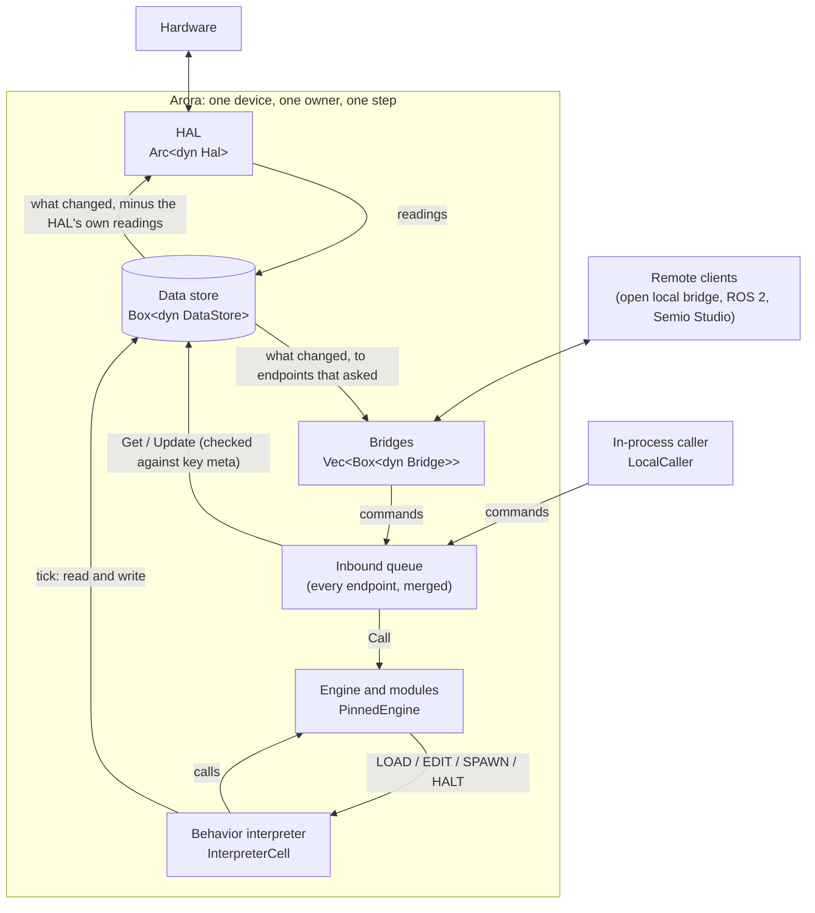

# The Arora runtime: the store, its seams and the step

An `Arora` is one device: a data store at the center, the parts that read and
write it around it, and one step that advances them all in a fixed order. This
page takes each part in turn, then walks one step and the loops that drive it.
It assumes the picture in the [crate readme](../readme.md);
[how a behavior interpreter works](../../arora-behavior/docs/interpreter-workflow.md)
covers what happens inside the behavior's tick.

## The device at a glance



The parts are the fields of `Arora` ([`src/lib.rs`](../src/lib.rs)):

| part | held as | role | defined in |
|---|---|---|---|
| data store | `Box<dyn DataStore>` | the keys and their values, the key meta, the change feed | [`arora-types`](../../arora-types/src/data/store.rs) |
| HAL | `Arc<dyn Hal>` | the hardware: readings in, outputs out, its keys described | [`arora-hal`](../../arora-hal/src/lib.rs) |
| bridges | `Vec<Box<dyn Bridge>>` | remote endpoints: commands in, changes out | [`arora-bridge`](../../arora-bridge/src/lib.rs) |
| engine | `PinnedEngine` | the modules and the dispatch of every call | [`arora-engine`](../../arora-engine/src/engine.rs) |
| method index | `FunctionIndex` | every described function, by function id | [`arora-behavior`](../../arora-behavior/src/lib.rs) |
| behavior interpreter | `InterpreterCell` | the one interpreter the step ticks | [`src/runtime.rs`](../src/runtime.rs) |
| clock | `Clock` | the device's time, advanced by each step | [`src/runtime.rs`](../src/runtime.rs) |

Each part meets the others only through the store and the engine, and only
inside a step or a call an embedder makes between steps. One owner, `Arora`, applies each in its own phase, so no two
race: the order of the step decides which write wins.

## The data store

The store ([`arora_types::data`](../../arora-types/src/data/mod.rs)) holds
values under keys:

- A **`Key`** is a `/`-separated path, such as `head/yaw`. A trailing
  `.attribute` (`head_yaw.position`) is a naming convention only: the store,
  the bridges and the key meta see one path.
- A **`StateChange`** is a batch of writes: keys to `set` (to a value, or to
  no value) and keys to `unset`. `DataStore::write` applies one; a **`State`**
  is a snapshot of every key.
- A **`Subscription`** is a change feed. Its first change is the current state
  of the keys it covers, and every change applied after it follows.
  Subscribers see only what changed: a write of the value a key already holds
  notifies nothing. `subscribe_prefix` covers one subtree.
- A **`Slot`** (`DataStore::slot`) is a direct handle to one key's value,
  resolved once: how the behavior tree binds its variables to keys.
- **`KeyMeta`** says what a key is beyond its value: its type `ty`, its range
  `min` / `max`, its `unit`, the `default` it rests at, a `description`, and
  whether it is `editable` by a remote writer. `set_meta` states it per key,
  `set_prefix_meta` per subtree; the most specific statement wins whole.

**A key is closed to remote writers unless its meta opens it.** Every remote
write — a bridge's `Update` or a `LocalCaller::update` — is checked in the
step: each key must be `editable`, and each value of a typed key must conform
to its type, or the whole change is refused and nothing is written. The
device's own writers — the HAL's readings, the behavior, the clock — are not
checked. The HAL opens its inputs by describing its keys
([below](#the-hal)); a host opens others with `set_meta` / `set_prefix_meta`
on the store it hands the builder; the `arora` binary's `--open` states the
empty prefix editable, which opens every key without meta of its own but the
runtime's. The build states the runtime's `arora` subtree closed — its clock
and its task runs' keys — so no wider prefix a host opens hands a remote the
device's time or a run's state; a host opens one of those keys by stating its
own meta. Over a `NamespacedStore`, that statement covers the device's own
subtree alone.

[`arora-simple-data-store`](../../arora-simple-data-store/readme.md) provides
the default store, `SimpleDataStore`, whose clones share their storage, and
`NamespacedStore`, a view confining a device to one subtree of a shared
store: devices built over views of one store each read, write and are
notified of their own keys alone.

## The seams

### The HAL

A HAL ([`arora_hal::Hal`](../../arora-hal/src/lib.rs)) is the hardware
boundary. The device takes three feeds from it at build:

- `updates()`: the readings the hardware reports, one `StateChange` each. The
  device is the stream's one poller.
- `describe_keys()`: what the HAL's keys are. Its inputs (actuator targets)
  are `editable`; its outputs (what it senses) are closed; each states its
  type. The device states each description to the store's key meta — those
  ready at build, then each later one at the start of the next step. A key
  whose meta the host stated keeps it: the HAL's description fills only the
  keys without meta, and replaces only what it stated itself. A store that
  keeps no meta opens none of the HAL's inputs, and the log says so.
- `try_send(&StateChange)`: what the device wrote, pushed each step without
  blocking.

`describe()` gives the device's model family and versions, which a Studio
connection reports. The device also registers the **HAL module**, a host
module under `arora_hal::hal_module::ID` whose functions `models`,
`model_glb` and `model_glbs` serve the 3D models of the HAL's components that
it states servable ([`src/hal_module.rs`](../src/hal_module.rs)).

The default HAL is `FakeHal`, in-process: it holds each joint position target
written to it and senses it back as the joint's position, and describes the
keys of the joints it is given (`FakeHal::add_joints`). `FakeHal::new()`
describes none.

### The bridges

A bridge ([`arora_bridge::Bridge`](../../arora-bridge/src/lib.rs)) is one
remote endpoint. A device holds zero or more; with none it runs standalone.
At build the device takes each endpoint's inbound stream (`take_inbound`,
once) and merges them all, with the in-process callers' queue, into one
inbound queue. Each event carries the endpoint it came from. An endpoint's
stream ending is logged as its disconnection; the device keeps running.

An inbound event is one of:

- `Inbound::Command`: a `BridgeOp` and the channel its reply goes back on.
  `Get` reads keys, `Update` writes a change (checked against the key meta),
  `Call` dispatches a function call through the engine, `ListKeys` lists the
  keys under a prefix with their meta, and `DescribeMethods` lists the method
  index under a name prefix with each function's signature. `ListMethods`,
  names only, is deprecated in favour of `DescribeMethods`.
- `Inbound::DataRequested(bool)`: whether anyone on this endpoint wants the
  device's data. A step sends what changed to an endpoint only while it asks:
  all of it or none, per endpoint.
- `Inbound::DeviceInfo`: a change of the remote's record of the device. An
  error is logged; the device keeps running.

Outbound, `try_send(&StateChange)` pushes what changed without blocking; the
bridge carries it on its own transport. The rest of the trait — device info,
device id, access requests — is the control plane `AroraBuilder::run` uses
around the loop: the front end shows the first bridge's identity and its
operator answers that bridge's access requests.

The default bridge is the **open local bridge**
([`arora-bridge-ws`](../../arora-bridge-ws)): a WebSocket server on
`ws://127.0.0.1:<port>`, 9000 by default, for any client on the machine, with
no account. `local_ws_bridge`, `local_ws_bridge_with(ServerConfig)` and
`serve_local_ws_bridge(server)` build it for a host composing its own bridge
set; dropping the bridge stops its server and frees the port. A Semio Studio
bridge is opt-in ([readme](../readme.md#semio-studio-is-opt-in)).

### The in-process caller

`Arora::caller()` hands out a `LocalCaller`: the device's client in the same
process, usable while `run` owns the device. Each operation puts the
`BridgeOp` a remote would send on the inbound queue before returning, and is
applied at the next step like a remote's, with the same checks. It writes
(`update`), lists keys and methods (`list_keys`, `describe_methods`), calls a
function (`Caller::call`) or invokes one by name (`invoke`, which takes two
steps: the signature on one, the call on the next), and starts and halts task
runs (`spawn`, `spawn_graph`, `halt`). Its futures fail with
`CallError::Generic` once the device is gone.

Between steps, an embedder holding the device calls synchronously instead:
`Arora::call` dispatches a call, `Arora::describe_methods` reads the method
index, and `arora::list_keys(store, prefix)` lists keys from any handle on the
store.

## Modules and the method index

The engine dispatches every call, by module id and function id, to one of
four kinds of module:

- **guests**, loaded from an artifact: a `wasm32-wasip2` component on the
  component executor (wasmtime natively, the browser's `WebAssembly` on
  `wasm32`), or a dynamic library on the native executor
  (`with_module`, `with_compiled_module`, `with_declared_module`,
  `with_module_dirs`);
- **host modules**, Rust functions in the process (`with_host_module`);
- the **HAL module** ([above](#the-hal));
- the **interpreter module** ([below](#the-behavior-interpreter)).

`build` claims each module's id and fails, naming both modules, on a second
claim. A function id belongs to one module: a guest exporting a function id
another module has is refused.

The **method index** (`FunctionIndex`) maps each described function id to
its `ModuleFunction`: the module, the function's name and its frozen
signature. It is what `DescribeMethods` answers, what a Groot tree's tags
resolve against, and what each tick hands the interpreter. A guest's exports
enter it:

- from the module's record, when the device's registry holds it at the
  header's id and version (`with_registry`, or the `records/` of its module
  directory). The record must describe the header, and every record it
  depends on must be present, or the build fails naming the module. A record
  at another version is logged and ignored;
- from the Rust declaration, for `with_declared_module`;
- otherwise from the header, which carries no type versions: only functions
  whose parameters and return are primitives or optionals over a scalar
  primitive are described. The others still dispatch.

Host modules contribute the functions they describe; the interpreter module
contributes its own and those the interpreter implements.

A built device changes its guests between steps: `Arora::load_module`,
`reload_module` and `unload_module`, refused with a `ModuleError` that leaves
the modules as they were. A reload swaps the code under the same id: a tree
calling the module reaches the new instance at its next call, which holds
none of the old one's state. A reload or an unload fails the calls to the
module the device received and has not applied, and halts the task runs
calling it. The native executor cannot unload a library.

What a guest may spend is its `GuestLimits` (`with_guest_limits`,
`with_module_limits`, `Arora::set_guest_limits`): by default one second per
call made outside a step and 256 MiB of memory. Under `Arora::run`, the guest
calls of one step share the step's period: natively, a call still running at
its deadline is interrupted, fails, and its module refuses calls until it is
reloaded, while the device keeps stepping
([`arora_engine::limits`](../../arora-engine/src/limits.rs)). In the browser
nothing interrupts a guest.

## The behavior interpreter

A device ticks one `BehaviorInterpreter`, injected once at build with
`with_behavior_interpreter` and never swapped. The default is an empty
`BehaviorTreeInterpreter`, which idles until a behavior is loaded into it.
The behavior is data — a `Graph` — and the interpreter is what runs it
([interpreter workflow](../../arora-behavior/docs/interpreter-workflow.md)).

The device registers the interpreter as a host module under
`arora_behavior::interpreter_module::ID`. Its functions act on the same
interpreter the step ticks:

| function | acts as |
|---|---|
| `LOAD` | `BehaviorInterpreter::load`: replace the behavior with a whole `Graph` |
| `EDIT` | `BehaviorInterpreter::apply`: apply a `GraphDiff` to it |
| `SPAWN` | `BehaviorInterpreter::spawn`: start a task run from a `Call` |
| `SPAWN_GRAPH` | `BehaviorInterpreter::spawn_graph`: start a task run whose program is a `Graph` |
| `HALT` | `BehaviorInterpreter::halt`: stop a task run |

A remote's `Call`, a `LocalCaller`, `Arora::call` and a behavior all reach
them through ordinary dispatch. A call from inside the interpreter's own tick
fails with "the behavior is being ticked; call between steps": the step holds
the interpreter for the length of the tick. `Arora::load_groot` and
`AroraBuilder::with_groot` lower a Groot tree against the method index and
`LOAD` it.

The methods an interpreter implements itself (`described_methods`) join the
method index under the interpreter module, to be spawned as task runs; a
direct call to one fails, saying to spawn it. A method id that a module
describes too fails the build.

The device follows each task run started through `SPAWN` or `SPAWN_GRAPH`:
after each tick it reads the run's status key, and logs when the run started,
and when it succeeded, failed, was halted or was interrupted by a module
change.

A tick's outcome decides the interpreter's fate:

| `tick` returns | the device |
|---|---|
| `Ok(BehaviorStatus::Running)` | keeps it, and clears any standing error |
| `Ok(BehaviorStatus::Done(Ok(())))` | drops it: nothing is ticked afterwards |
| `Ok(BehaviorStatus::Done(Err(e)))` | raises `e` and drops it |
| `Err(e)` | raises `e` and keeps it: the next step ticks it again |

A raised error stands on `Arora::behavior_error()`, a watch receiver, until a
tick succeeds; each distinct message is logged once. A failing behavior never
stops the device.

## One step

`Arora::step(dt)` ([`src/runtime.rs`](../src/runtime.rs)) is synchronous and
never waits:

```mermaid
sequenceDiagram
    autonumber
    participant Step as Arora::step(dt)
    participant Store as Data store
    participant Engine
    participant Interp as Interpreter
    participant HAL
    participant Bridges

    Step->>Step: sweep what the HAL and the inbound queue already hold
    Step->>Store: state the HAL's new key descriptions
    Step->>Store: write arora/time and arora/dt
    Step->>Store: apply the HAL's readings, oldest first
    Step->>Store: apply the inbound events, in arrival order
    Note over Step,Engine: a Call dispatches through the engine; each command is answered on its channel
    Step->>Interp: tick (store, engine, method index)
    Interp->>Store: read inputs, write outputs
    Step->>Store: read the task runs' status keys
    Step->>Store: drain the change feed into one StateChange
    Step->>HAL: try_send what changed, minus its own readings
    Step->>Bridges: try_send what changed, to endpoints that asked
```

| phase | function | what it does |
|---|---|---|
| sweep | `sweep_now` | move every reading and inbound event already delivered into the pending buffer, without waiting |
| key descriptions | `describe_hal_keys` | state the HAL's new key descriptions to the store's key meta, before anything writes |
| clock | `tick_clock`, `publish_clock` | advance the clock by `dt` and write `arora/time` and `arora/dt` |
| readings | `apply_sensors` | write the HAL's readings, oldest first, and keep what they set |
| events | `apply_events`, `apply_command` | apply the commands and endpoint events in arrival order, replying to each command |
| behavior | `tick_behavior` | tick the interpreter |
| task runs | `report_task_runs` | log the task runs that started or ended |
| flush | `flush` | drain the store's change feed into one `StateChange`, a later write of a key replacing an earlier one |
| out | `write_hal`, `write_bridges` | when anything changed, push it to the HAL and to each endpoint that asked |

The order is the precedence: **behavior ▸ bridge ▸ HAL ▸ previous step**, and
within each, the later write wins. The behavior ticks last, over this step's
clock, readings and remote writes, and its writes are the step's final word.
The HAL is not sent back a reading it reported, unless something overwrote it
in the step; the bridges are sent everything.

**Built-in keys.** `arora/time` is the device's time and `arora/dt` the
step's `dt`, both `U64` nanoseconds
([`arora_behavior::built_in`](../../arora-behavior/src/built_in.rs)). They are
written first so that everything in the step reads this step's time, and they
travel outbound like any other change: a remote derives the device's step
rate from them, or filters them out with `built_in::is_built_in`. The clock
starts at zero, or at `with_start_time`: devices started at the same time and
stepped with the same `dt`s read the same `arora/time`.

`step` fails with `RuntimeError::Store` only when the store refuses a write
of the clock or a reading. A refused command is answered as such, and a
failing behavior is [raised](#the-behavior-interpreter); neither fails the
step.

## Driving the steps

**From your own clock.** Call `step(dt)` once per frame: from
`requestAnimationFrame` in a browser, from a simulation, or from a preview
stepping a fixed virtual `dt` faster than real time. The opening sweep is the
whole inbound drain, so a directly stepped device sees what a self-paced one
sees.

**Self-paced.** `Arora::run(period)` steps at a fixed cadence
(`Arora::DEFAULT_STEP_PERIOD`, 10 ms, is the default `AroraBuilder::run`
uses). Between steps it awaits the next tick and the HAL and inbound feeds in
one select, biased toward the tick, so a flood of events cannot starve the
cadence; whatever arrives is only buffered, never applied outside a step. The
`dt` handed to `step` is the time measured since the previous step. A step
that overruns the period shifts the next tick out rather than firing a burst.
`run` returns only on a step error.

**Stopping is dropping.** Each step runs inside a single poll, so dropping the
future of `run` lands between steps and leaves the device consistent. The
future of `AroraBuilder::run` holds the front end, the device, its bridges and
their servers, so dropping it tears all of it down.

**The full run.** `AroraBuilder::run` builds the front end first (installing
its log sink), fills the default bridge when none was given, builds the
device, hands the front end a subscription to the store (`Frontend::on_ready`),
then steps with `Arora::run` while answering the first bridge's access
requests through the operator in the same future.

**Natively** the caller brings a Tokio runtime and the cadence sleeps on its
timer. **In the browser** the future is polled by
`wasm_bindgen_futures::spawn_local` and the cadence sleeps on a JS timer; a
dedicated Web Worker keeps its full rate while the page is hidden, where the
main thread's timers are throttled. [`arora-web`](../../arora-web) wraps the
device for JavaScript.

## Threads and tasks

`Arora` owns no executor and spawns nothing: its inbound seams are streams it
polls itself and its outbound seams are non-blocking pushes. It is not
`Send` — the interpreter is shared between the step and the interpreter
module through `Rc<RefCell<…>>` — so it lives on the thread that built it,
and its `run` is polled there.

What runs elsewhere belongs to a seam or to the engine: the open local bridge
serves on a Tokio task it spawns and cancels when dropped; the terminal UI
draws on a thread of its own; the component executor advances an epoch
counter from one thread for the whole process, which is how a guest call
overrunning its deadline is interrupted; a HAL or a bridge runs whatever its
transport needs.

## Assembling a device

`Arora::builder()` returns an `AroraBuilder`; every setter returns it, so
calls chain.

| setter | default |
|---|---|
| `with_data_store` | a private `SimpleDataStore` |
| `with_hal` | `FakeHal` |
| `with_bridge` (repeatable) | none; `AroraBuilder::run` serves the open local bridge |
| `with_behavior_interpreter` | an empty `BehaviorTreeInterpreter` |
| `with_module`, `with_compiled_module`, `with_declared_module`, `with_host_module`, `with_module_dirs` | no module |
| `with_registry` | an empty `LocalRegistry` |
| `with_groot` | no behavior |
| `with_start_time` | zero |
| `with_guest_limits`, `with_module_limits` | `GuestLimits::default()` |
| `with_step_period` (`run` only) | `Arora::DEFAULT_STEP_PERIOD` |
| `with_frontend` (`run` only) | `standard_frontend()`: the terminal UI on a terminal, headless otherwise |
| `with_device` (`run` only) | the local bridge on port 9000 |
| `with_studio` (`run` only, `studio-bridge`) | the open local bridge |

`build` is synchronous. It fails, naming what does not fit: a guest that does
not load or that its record does not describe, two modules under one id, a
method both a module and the interpreter describe, a Groot tree that does not
load. The `run` family in [`src/run.rs`](../src/run.rs) — `run`,
`run_with_hal`, `run_with`, `run_with_frontend` — is shorthand for a builder
and its `run`.

## Source map

| what | where |
|---|---|
| `Arora`, `AroraBuilder`, `LocalCaller`, the interpreter module's wiring | [`src/lib.rs`](../src/lib.rs) |
| the step, its phases, `run`, the cadence | [`src/runtime.rs`](../src/runtime.rs) |
| the `run` family, the open local bridge, `DeviceCli`, `RunnerArgs` | [`src/run.rs`](../src/run.rs) |
| the device a runner is, its directory, its module directories | [`src/device.rs`](../src/device.rs), [`src/device_dir.rs`](../src/device_dir.rs), [`src/module_dir.rs`](../src/module_dir.rs) |
| the operator and the front ends | [`src/operator.rs`](../src/operator.rs), [`src/tui/mod.rs`](../src/tui/mod.rs) |
| the Semio Studio connection | [`src/studio/mod.rs`](../src/studio/mod.rs) |
| the data store | [`arora-types/src/data`](../../arora-types/src/data/store.rs) |
| the HAL, the bridge | [`arora-hal`](../../arora-hal/src/lib.rs), [`arora-bridge`](../../arora-bridge/src/lib.rs) |
| the interpreter, its module, the built-in keys | [`arora-behavior`](../../arora-behavior/readme.md) |

Tests that pin this page down, by name: in `src/runtime.rs`,
`run_paces_steps_at_the_period`,
`built_in_clock_is_published_to_the_store_each_step`,
`the_clock_is_forwarded_outbound`, `a_remote_write_reaches_only_the_devices_inputs`,
`a_remote_write_takes_only_the_declared_type`,
`a_remote_that_asks_for_nothing_is_not_written_to`,
`the_hal_is_not_told_what_it_reported`,
`devices_sharing_a_store_flush_their_own_namespace_alone`,
`dropping_the_run_future_stops_the_device_cleanly` and
`a_guest_call_overrunning_its_step_is_interrupted_and_the_device_keeps_stepping`;
in `src/lib.rs`, `a_failing_behavior_is_state_not_a_stop`,
`a_caller_reaches_a_running_device`,
`the_hal_s_inputs_are_listed_open_and_its_outputs_closed`,
`open_leaves_the_runtime_s_keys_closed`,
`a_host_opens_one_of_the_runtime_s_keys_by_its_own_meta` and
`a_device_over_a_shared_store_closes_its_own_runtime_keys`;
[`src/stepping_tests.rs`](../src/stepping_tests.rs), a remote driving a task
run end to end; [`src/module_reload_tests.rs`](../src/module_reload_tests.rs);
and [`tests/local_ws_bridge.rs`](../tests/local_ws_bridge.rs), a WebSocket
client on a running device.
