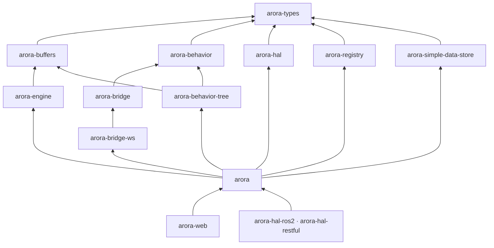
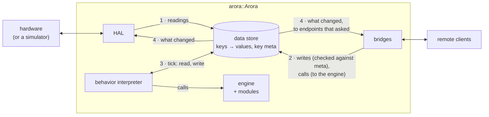
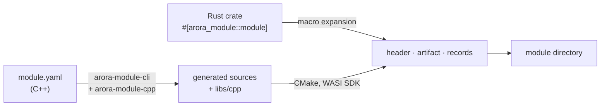

# Architecture

How the code is organized: the crates and how they depend on each other,
where each concept lives, and how a device, the engine and the build fit
together. Read the [concepts](overview.md) first; the
[design decisions](design_decisions.md) give the reasons.

## The crates, in layers

Arora is one Cargo workspace of focused crates. A crate depends only on
crates of its own layer or of the layers above it in this list:

| Layer | Crates | What it holds |
|---|---|---|
| Vocabulary | `arora-types` (+ `arora-types-derive`), `arora-buffers` | values, types, calls, records, the data-store vocabulary; the binary form values cross module boundaries in |
| Support | `arora-util`, `arora-vfs`, `wasi-sdk` | a C helper, an in-memory file tree for code generation, the WASI SDK for C++ guests |
| Interfaces | `arora-behavior`, `arora-hal`, `arora-bridge`, `arora-registry`, `arora-simple-data-store` | the behavior, HAL and bridge traits a device is built from; the type registry; the reference store |
| Engine | `arora-engine` | loading modules and dispatching calls to them, on every executor |
| Modules | `arora-module` (+ `arora-module-macros`), `arora-module-authoring/*` | declaring a module in Rust; generating one from a `module.yaml` |
| Behaviors | `arora-behavior-tree` (+ `-types`, `-types-yaml`) | the behavior-tree interpreter |
| Runtime | `arora` | the device: the step, the builder, the runner |
| Edges | `arora-bridge-ws`, `arora-bridge-ros2`, `arora-msgs-ros2`, `arora-hal-ros2`, `arora-hal-restful` | bridges, ROS 2 messages, robot HALs and their runners |
| Front ends | `arora-web`, `arora-cli` | the device in a browser; a command line that loads a module and calls it |
| Libraries | `arora-animation` (+ `arora-animation-module`), `arora-geometry`, `arora-graphics-types`, `arora-dataflow-nodes` | computation on `Value`s, usable inside or outside a device |

The dependencies that shape the design:



Two seams keep the layers apart:

- **`CallBridge`** (`arora_types::call`): anything that can call a module
  function by id. The engine implements it; the behavior tree calls through
  it. So `arora-behavior-tree` does not depend on the engine, and runs against
  any `CallBridge` — a test double, a remote.
- **The device's traits** (`Hal`, `Bridge`, `BehaviorInterpreter`,
  `DataStore`): `arora` owns one of each kind (a vector of bridges) and knows
  them only through their traits, so a robot, a transport or an interpreter
  plugs in without touching the runtime.

[Building](building.md#releasing) lists which crates are published to
crates.io. The robot HALs and their runners, `arora-cli`, `arora-module-cli`,
`arora-module-cpp`, `arora-registry-remote` and the modules built for tests
are not.

## Repository layout

```
arora-sdk/
├── crates/                    the crates of the table above
│   ├── arora/                 the device runtime and the `arora` runner
│   │   └── docs/              the runtime's data flow
│   ├── arora-engine/          the engine; wit/ holds the arora:module world
│   ├── arora-module-authoring/
│   │   ├── core/              analysis and resolution of module.yaml declarations
│   │   ├── cli/               arora-module-cli, the generator front end
│   │   ├── rust/              the Rust generator
│   │   └── cpp/               the C++ generator
│   └── …
├── modules/                   modules built in this workspace
│   ├── animation/             the module @arora/animation (crate arora-animation-module)
│   ├── say-silent/            the speech contract with no speaker, for devices without audio
│   ├── polly/                 speech by AWS Polly, a native module
│   ├── test-rust-wasm/        a Rust guest, declared with arora-module
│   ├── test-rust-component/   the arora:module world written by hand, for the executors' edge cases
│   ├── test-behavior-tree-nodes/  behavior-tree nodes as a guest, for tests
│   └── test-cpp/, test-cpp-2/ C++ guests, the second calling the first
├── libs/cpp/                  the C++ support C++ guests link (arora-cpp-component)
├── examples/
│   ├── modules/cpp/           a C++ module built into a module directory
│   └── policy-modules/        the Microduck: learned policies as modules (its own workspace)
├── tests/                     arora-integration-tests: guests loaded and called end to end
├── docs/                      the pages this one belongs to
├── .cargo/config.toml         bindeps, and the browser target's settings
└── rust-toolchain.toml        the pinned nightly and the wasm32-wasip2 target
```

Robot support lives outside this repository, against the published crates:
NAO and Pepper in [arora-aldebaran](https://github.com/semio-ai/arora-aldebaran).

## The device

`arora::Arora` owns the store, the HAL, the bridges, the engine and one
behavior interpreter, and advances them together in `Arora::step(dt)`:



- **One owner, one order.** The parts never address each other; the step
  applies each one's traffic in its phase, so the step's order decides which
  write wins (behavior over remote over hardware), and nothing locks.
- **A step never waits.** It takes what the HAL and the bridges have already
  delivered (`try_recv`) and hands them what changed (`try_send`); each HAL and
  bridge owns whatever I/O task it needs. The same loop therefore runs on a
  native thread and in a browser, where a page steps it.
- **Remote writes are checked once,** in the step, against the store's key
  meta: every bridge gets the same rule.
- **Everything a remote can do is a module call.** Loading and editing the
  behavior, spawning and halting task runs (the **interpreter module**), and
  fetching the device's 3D models (the **HAL module**) are functions of host
  modules the runtime builds, so a bridge lists and calls them like any other
  function, with no special case.
- **Many devices, one store.** `NamespacedStore` gives a device a view of a
  shared store under its own prefix, so one process can run many devices over
  one store.

[The runtime's data flow](../crates/arora/docs/runtime-and-data-flow.md)
details each phase, the builder and the threads.

## The engine

`arora-engine` loads modules and dispatches calls to them. It selects an
**executor** by the `executor.name` a module's header carries:

| Executor | Name | Where | What it runs |
|---|---|---|---|
| `ComponentExecutor` | `wasm-component` | native (`wasmtime-host`) | a `wasm32-wasip2` component of the `arora:module` world, on wasmtime |
| `BrowserComponentExecutor` | `wasm-component` | `wasm32` | the same component, on the browser's `WebAssembly` |
| `NativeExecutor` | `native` | native (`native-host`) | a shared library, through `libloading` |

Beside them, a **host module** (`ModuleBuilder`, `HostModule::of::<M>()`)
registers Rust functions in the same process under a module id; the engine
dispatches to it exactly as to a guest.

- **The `arora:module` world** ([`wit/arora-module.wit`](../crates/arora-engine/wit/arora-module.wit))
  is the guest contract: a component exports `functions` and `dispatch`, and
  imports the host's `dispatch` (to call other modules) and WASI 0.2 with no
  directory and no socket. Arguments and results cross as Arora Buffers.
- **Direct and indirect dispatch.** A call names a function by module and
  function id (`arora_call`), or a callable the host registered
  (`arora_call_indirect`), which is how a behavior tree reaches each of its
  nodes. See [dispatch](dispatch.md).
- **Compile once, instantiate per engine.** A `CompiledModule` is shared by
  every device that loads it; each gets its own instance and state.
- **Limits.** Each call has a time budget and each guest a memory limit
  (`GuestLimits`); a guest call that overruns traps, and its module is
  instantiated afresh before its next call.
- **The engine is pinned** (`Pin<Box<Engine>>`): a guest's call to another
  module re-enters the engine while it is borrowed, so the executors reach it
  through a stable raw pointer.

## Modules: from declaration to module directory

Whatever its language, a module ends as a **module directory**: its header
(`header.json`), its one artifact (`.wasm`, or a shared library), and
optionally its records (`records/`). Two paths lead there:



- **A Rust module declares itself in Rust**
  ([`arora-module`](../crates/arora-module/readme.md)). The macros yield the
  header, the records, the functions a host registers, the typed client stubs
  and the artifact's entry points. No `module.yaml`, no build script.
- **A module in another language ships a `module.yaml`.** Its `build.rs`
  stages the code generators and runs its CMake project, which calls
  `arora-module-cli`: it resolves the module's types and imports against the
  records it is given and runs the language's generator
  ([`arora-module-authoring`](../crates/arora-module-authoring/cli/readme.md)).
  CMake then builds the guest with the [WASI SDK](building.md#the-wasi-sdk).
  The generated sources are rebuilt from the YAML on every build: edit the
  YAML, never them.

A device loads module directories from its device directory's `modules/` and
from `--module` (`AroraBuilder::with_module_dirs`); an embedder can also hand
it a header and bytes, a compiled module, or a host module directly.

## Records and the registry

The engine identifies everything by UUID; **records** give those UUIDs
meaning across machines. A record (`arora_types::record`) is a versioned
declaration of a structure, an enumeration, a module or a folder; freezing it
pins the version of every type it refers to. `arora-registry` holds records in
memory or reads them from record files; `arora-registry-remote` (unpublished)
reads them from Semio's hosted store. A device's registry is what describes
its modules' functions with full signatures. See [records](records.md).

## The browser

`arora-web` compiles `arora` for `wasm32-unknown-unknown` without default
features — no wasmtime, no `libloading` — and exports the device to
JavaScript as `AroraRuntime`. Its engine runs guests on the browser's
`WebAssembly` through `BrowserComponentExecutor`, which gives a component the
`host` interface and the WASI imports itself: the component a native device
loads runs unchanged in a page. The page paces the steps. See
[`arora-web`](../crates/arora-web/readme.md).

## The build

`cargo build` builds the default members; `cargo test` additionally builds
the guests the tests load. Cross-target artifacts — the code generators for
the host, the guests for `wasm32-wasip2` — are cargo **artifact dependencies**
(`-Z bindeps`), which is why the workspace pins a nightly toolchain. C++
guests are built by CMake, invoked from their `build.rs`, with a WASI SDK the
[`wasi-sdk`](../crates/wasi-sdk) crate downloads. See
[building](building.md).

## CI

[`continuous.yml`](../.github/workflows/continuous.yml) tests on every pull
request and every push to `main`, as parallel jobs: the tests of the default
members, the ROS 2 Zenoh backend, the robot runners and their Studio builds,
clippy and rustfmt, the browser tests in headless Firefox, coverage on `main`,
and a link check of the Markdown. A pull request builds only the members its
diff reaches. [Testing](testing.md#what-ci-runs) details each job and how the
selection is made.

[`release.yml`](../.github/workflows/release.yml) publishes, on every push to
`main`, each publishable crate whose version is not yet on crates.io
([releasing](building.md#releasing)).
