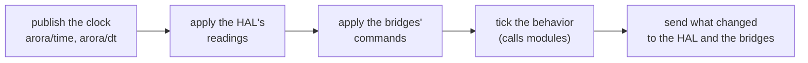

# Concepts

Arora's ideas, one at a time, each built on the ones before it. Every section
is short and ends where a crate's own documentation takes over. For how the
code is laid out, read the [architecture](architecture.md) next; for why it is
built this way, the [design decisions](design_decisions.md).

The [Microduck example](../examples/policy-modules/README.md) shows every
concept on a real robot, simulated: it is the place to see them work together.

## 1. A device

A **device** is one running Arora: a robot, a simulated robot, a face on a
screen, a page in a browser. In code it is one `arora::Arora`
([`arora`](../crates/arora/readme.md)), and everything below is a part it
owns.

## 2. Keys, values and the store

A device's state is a set of **values** under **keys**, held in one **data
store**.

- A **key** is a `/`-separated path: `head/yaw`, `arora/time`,
  `display/face/compressed`. A trailing `.attribute` (`head_yaw.position`) is
  only a naming convention some HALs follow; to stores, bridges and
  subscriptions it is one more character of the name.
- A **value** is an `arora_types::value::Value`: a primitive (`F64`, `Boolean`,
  `String`, …), an option, an array, or a structure or enumeration of a
  declared type ([`arora-types`](../crates/arora-types/readme.md#values)).
- The **store** (`arora_types::data::DataStore`) reads and writes values,
  reports what changed, and lets a reader subscribe to a key or a subtree.
  `SimpleDataStore` ([`arora-simple-data-store`](../crates/arora-simple-data-store/readme.md))
  is the implementation every device uses unless it is given another.

The store is the only thing the other parts share. None of them talks to
another directly: each reads the store or writes it.

## 3. Key meta: what a key is, and who may write it

The store also holds each key's **meta** (`KeyMeta`): its type, unit, range,
rest value, description, and whether it is **editable**. Meta is the device's
statement to the outside world:

- **A key is closed to remote writers unless its meta opens it.** A remote
  write to a closed key, or of a value not of the key's declared type, is
  refused whole.
- Meta can be stated for one key (`set_meta`) or for a subtree
  (`set_prefix_meta`); a key's own meta wins over its subtree's. The `arora`
  runner's `--open` opens every key that has no meta of its own, for a
  sandbox — every key but the runtime's.
- The runtime's own keys under `arora/` — its clock (`arora/time`,
  `arora/dt`), its behavior's revision (`arora/behavior/revision`) and its
  task runs' (`arora/tasks/…`) — are closed: the runtime
  states their subtree closed when the device is built, so no wider prefix
  opens them. A host opens one by stating that key's own meta.
- The device's own writers — its hardware, its behavior — are never checked:
  meta constrains the outside, not the device.

## 4. The HAL: the device's hardware

The **HAL** (hardware abstraction layer, `arora_hal::Hal`,
[`arora-hal`](../crates/arora-hal/readme.md)) is the boundary between the
device and its hardware. It reports what the hardware senses as changes to
keys, receives what the device wants actuated as changes to keys, and
**describes its keys**: its inputs (actuator targets) editable, its outputs
(sensed values) not. That description is what opens a robot's joints to a
remote, with no configuration of its own.

A robot HAL talks to motors and sensors; a simulator is another HAL (the
Microduck runs on a MuJoCo HAL), and so is a renderer drawing a face. Swapping
the HAL is how the same device runs on a simulator and on the robot.

## 5. Modules: typed functions

A **module** is a set of **functions** a device can call: a learned policy, a
speech synthesizer, an animation player. Each module, function and parameter
is identified by a UUID, so names can change without breaking callers.

- **A call has in and out parameters.** Arguments go in; the return value and
  the parameters the function wrote come back. A module never writes keys
  itself: whoever calls it decides whether its outputs go to keys, and which.
- **A module runs where its executor runs it.** A WebAssembly component
  (`wasm32-wasip2`, the `wasm-component` executor) runs natively under
  wasmtime and unchanged in a browser; a native shared library runs under the
  `native` executor; and Rust code linked into the host registers as a **host
  module**. The [engine](../crates/arora-engine/readme.md) loads modules and
  dispatches calls to them, whatever their executor.
- **A module carries its interface in a header** (`header.json`): its id, its
  executor, and its functions with their typed parameters. A device carries a
  module as a **module directory** — the header, the artifact, and optionally
  the module's records.

A module written in Rust declares its interface with the
[`arora-module`](../crates/arora-module/readme.md) macros, and everything
else — header, records, client stubs, entry points — comes from that
declaration:

```rust
#[arora_module::module(id = "a1a6bb9a-…", name = "polly", version = "0.1.0")]
pub mod polly {
  #[export(id = "e1b4bda7-…")]
  pub fn say(#[param(id = "fb3787f2-…")] text: String) -> Status { … }
}
```

A module in another language (C++ today) declares it in a `module.yaml`, from
which [`arora-module-cli`](../crates/arora-module-authoring/cli/readme.md)
generates the bindings. A function that cannot finish within a step returns
`Running` and is called again on the next one
([long-running functions](async-functions.md)).

## 6. Types and records

A function's parameters are typed, and a type is identified by its UUID too.
A **record** is a versioned declaration of a structure, an enumeration or a
module, as a registry stores and serves it; a **frozen** record pins the
exact version of every type it refers to, so two machines agree on what a
value means. The **type registry**
([`arora-registry`](../crates/arora-registry/readme.md)) holds records and
resolves them. A device given a module's records describes that module's
functions with their full signatures. See [records](records.md).

## 7. Behaviors: what the device does each step

A **behavior** is the program a device runs; an **interpreter**
(`arora_behavior::BehaviorInterpreter`,
[`arora-behavior`](../crates/arora-behavior/readme.md)) runs it, one tick per
step, against the store, calling module functions as it goes.

- The default interpreter runs **behavior trees**
  ([`arora-behavior-tree`](../crates/arora-behavior-tree/readme.md)). Each
  step ticks the tree once, and each node answers `Success`, `Failure` or
  `Running`. Control nodes (sequence, fallback, parallel, …) and a few data
  and string nodes are native; every other leaf calls a module function, its
  arguments read from keys (`{head/yaw}`) or tree-local variables
  (`{.pose}`), its outputs written back to them. The native `scatter` writes
  a function's outputs to several keys at once. A tree is written in the
  `.bt` [text language](../crates/arora-behavior-tree/docs/text.md), as
  Groot XML, or as YAML.
- A behavior is **loaded** and **edited** through an ordinary module — the
  **interpreter module** — so a remote changes what a device does by calling
  functions, like any other call.
- Beside the main behavior, a device runs **task runs**: a function call or a
  graph spawned to run until it ends or is halted, with its status published
  under `arora/tasks/…` keys.

## 8. Bridges: remote clients

A **bridge** (`arora_bridge::Bridge`,
[`arora-bridge`](../crates/arora-bridge/readme.md)) is an endpoint through
which remote clients reach the device: they read keys, write the keys the
device opens, list keys and functions, and call functions. A bridge keeps no
state of its own about the device: it relays what the store and the
device's modules say. A device holds any number of bridges, or none.

- The **open local bridge** ([`arora-bridge-ws`](../crates/arora-bridge-ws/README.md))
  serves JSON messages over a WebSocket on the local machine. It is what a
  device serves when no other bridge is given.
- The **ROS 2 bridge** ([`arora-bridge-ros2`](../crates/arora-bridge-ros2/README.md))
  exposes keys as topics, functions as services and task runs as actions, with
  exposure profiles such as ROS4HRI.
- **Semio Studio** connects through a bridge built into `arora` behind the
  opt-in `studio-bridge` feature: a build without it has no Studio code at
  all.

## 9. The step

A device advances in **steps**. `Arora::step(dt)` is synchronous and never
waits:



The order is the precedence: when two writers set one key in a step, the
behavior wins over a remote, and a remote over the hardware. The device is
the one owner of its state, so nothing locks and nothing races. A runner
steps it on a fixed period (10 ms by default); a browser page steps it from
its own frame loop. The [runtime's data flow](../crates/arora/docs/runtime-and-data-flow.md#one-step)
details every phase.

## 10. Running a device

- The **`arora` runner** ([`arora`](../crates/arora/readme.md#run-the-device-runner))
  is a device with a stand-in HAL, serving the open local bridge: enough to
  load behaviors and modules and drive them remotely.
- A **robot runner** is the same with the robot's HAL: `arora-ros2`
  ([`arora-hal-ros2`](../crates/arora-hal-ros2/readme.md)) and `arora-restful`
  ([`arora-hal-restful`](../crates/arora-hal-restful/readme.md)) here, the
  NAO and Pepper runners in
  [arora-aldebaran](https://github.com/semio-ai/arora-aldebaran). A new robot
  gets a runner of its own, in a repository of its own, against the published
  crates.
- A device has a name and a **device directory**, which holds what it keeps
  between runs: the module directories it loads at start.
- In a browser, [`arora-web`](../crates/arora-web/readme.md) runs the same
  device, its components executed by the browser's `WebAssembly`.

## 11. Libraries built on the vocabulary

Some crates compute on `Value`s and are usable inside or outside a device:

- [`arora-animation`](../crates/arora-animation/readme.md): keyframed
  animations and their exact evaluation, served to devices as the module
  `@arora/animation` ([`modules/animation`](../modules/animation/readme.md)).
- [`arora-geometry`](../crates/arora-geometry/README.md) and
  [`arora-graphics-types`](../crates/arora-graphics-types/README.md): vectors,
  quaternions, transforms and colours as Arora types.
- [`arora-dataflow-nodes`](../crates/arora-dataflow-nodes/README.md): a
  vocabulary of dataflow nodes (arithmetic, vectors, kinematics) as the
  functions of `@arora/dataflow`, `@arora/geometry` and `@arora/kinematics`,
  which a host serves by wrapping its `CallBridge`.
