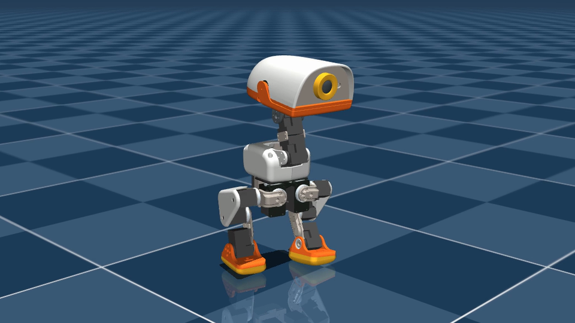
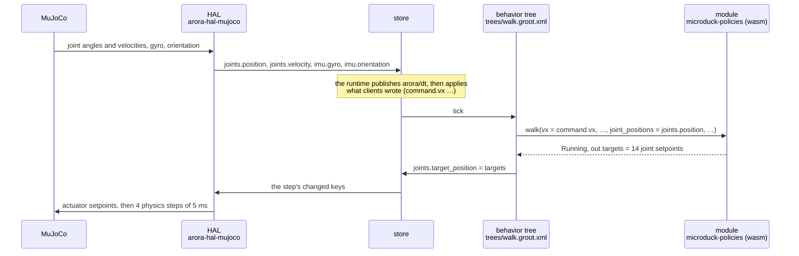
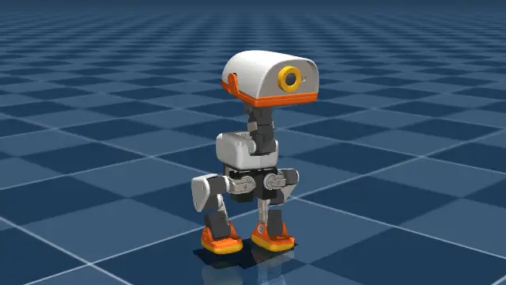
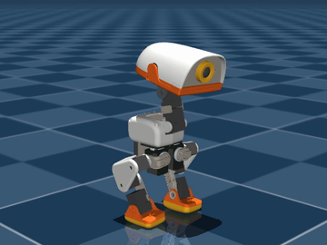
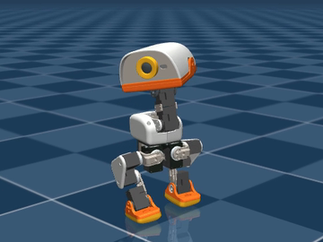
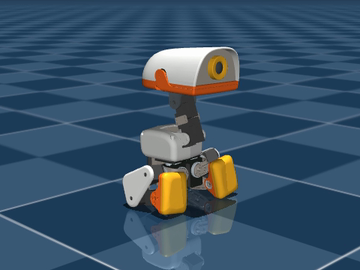
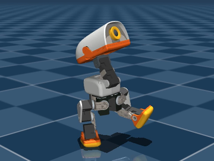

# Microduck on Arora: a walking policy in a WebAssembly module



<sub>Robot model and policies: the [Microduck](https://github.com/pollen-robotics/microduck_rl)
by Pollen Robotics, Apache-2.0.</sub>

This is Pollen Robotics' **Microduck**, a 14-joint toy biped, walking in the
MuJoCo simulator under its published neural networks. The networks do not run
in Python or in the simulator: they run inside a WebAssembly module that an
Arora device loads, and a behavior tree decides, every 20 ms, which of them
drives the legs — walk, stand, sit, rise, kick. MuJoCo is the device's HAL and
publishes the keys a real robot's HAL publishes, so the device is the one that
would run on the robot, with the robot's HAL in place of the simulator's.

Everything below runs on a laptop, headless; driving it live from Semio Studio
is an opt-in build.

## Arora in this example

| Arora concept | What it is here | Where |
|---|---|---|
| **Device** | The `arora-microduck` binary: one process that owns the store and steps every part in turn, every 20 ms, on the standard Arora run. | [`crates/arora-microduck`](crates/arora-microduck/src/lib.rs) |
| **HAL** | MuJoCo itself, run in the device's process and presented as the robot: the HAL loads the MJCF, owns the simulation and steps its physics every control period, publishes the joints and the IMU as keys, and applies the joint setpoints written to its keys. | [`crates/arora-hal-mujoco`](crates/arora-hal-mujoco/src/lib.rs) |
| **Store and keys** | The device's shared state, addressed by `/`-separated paths: `joints.position`, `imu.orientation`, `command.vx`, `joints.target_position`, the runtime's clock `arora/dt`, the simulator's `sim/base.position`. A trailing `.position` is a naming convention. | [the keys a client may write](#over-the-local-bridge) |
| **Module** | `microduck-policies`: the seven ONNX networks and the code that feeds them, compiled to a `wasm32-wasip2` component. Its functions: `walk`, `stand`, `sit`, `rise`, `skill`, `fallen`, `head_clip`, `joint_names`. | [`modules/microduck-policies`](modules/microduck-policies/src/lib.rs) |
| **Behavior tree** | Groot XML. Each leaf calls a module function, its parameters bound to keys (`{imu.gyro}`) or literals; Arora's own nodes (`Fallback`, `Parallel`, `RegexMatch`, …) choose which leaves run. | [`trees/`](trees) |
| **Bridge** | How a client outside the process reads and writes keys while the device runs: the open local bridge on `ws://127.0.0.1:9000`, or Semio Studio in a build with the `studio` feature. | [Drive it live](#drive-it-live) |

### One step

Every 20 ms of simulated time, with the `walk` tree:



The module never touches a key: `walk` takes the sensors as **in**
parameters and returns the setpoints in its **out** parameter `targets`; the
tree's leaf binds both to keys, so the tree reads the inputs and writes the
output:

```xml
<Walk vx="{command.vx}" vy="{command.vy}" vyaw="{command.vyaw}" head="{command.head}"
      dt_ns="{arora/dt}" gyro="{imu.gyro}" orientation="{imu.orientation}"
      joint_positions="{joints.position}" joint_velocities="{joints.velocity}"
      targets="{joints.target_position}" />
```

`walk` returns `Running`, so the tree calls it again at the next step: that
repetition is the control loop. Switching policies is the tree calling another
leaf — `Sit`, `Skill skill="kick_left"` — or `walk` itself handing over to the
standing network when the command is zero.

## Run it

You need Rust (the pinned nightly installs itself from `rust-toolchain.toml`),
`git`, `curl`, and [`uv`](https://docs.astral.sh/uv/) for the Python tools.
From this directory:

```sh
tools/fetch-assets.sh               # once: the Microduck model and policies, at pinned revisions
eval "$(tools/setup-mujoco.sh)"     # in each shell: MuJoCo 3.12.0, for the build and the run
cargo run --release -p arora-microduck -- --tree trees/walk.groot.xml --command 0.3 0 0 --duration 10
```

The first build takes several minutes. The run simulates ten seconds of
walking at 0.3 m/s, as fast as the machine allows, and says what happened:

```text
[2026-10-29T10:44:41Z INFO  arora] loaded module 'microduck-policies' (5c0a2e7f-6b3d-4d9a-9a41-2f6c7d1e8b90): 8 function(s)
[2026-10-29T10:44:41Z INFO  arora] behavior loaded from a Groot tree: 1 node(s), running from the next step
simulated 10.00 s: travelled 1.167 m to (1.134, -0.272), height 0.120 m (min 0.113), upright
```

`cargo test` runs every crate's tests, the simulated runs of
[`tests/simulation.rs`](crates/arora-microduck/tests/simulation.rs) included:
it stands, walks, stops, sits and rises, kicks, takes requests, and opens to
a client only the keys it should.

## Watch it

`--record` writes one CSV row per step — every joint's position and setpoint,
the base's pose — and `tools/replay.py` renders it with MuJoCo, offscreen:

```sh
mkdir -p recordings
cargo run --release -p arora-microduck -- --tree trees/walk.groot.xml --command 0.3 0 0 \
    --duration 10 --record recordings/walk.csv
uv run --python 3.12 --with mujoco --with numpy --with imageio --with imageio-ffmpeg \
    python tools/replay.py recordings/walk.csv --video recordings/walk.mp4
```



The replay sets the recorded state and runs no physics: the video is exactly
what the run did. `--view` replays it in MuJoCo's interactive viewer instead
(run it with `mjpython` on macOS).

## The demos

Each tree in [`trees/`](trees) is a demo; pass it with `--tree`.

| `stand` | `showcase` | `sit_rise` | `kick` |
|---|---|---|---|
|  |  |  |  |

| Tree | What it does | Try |
|---|---|---|
| `walk` | Walks at the commanded twist (`command.vx` m/s forward, `command.vy` m/s left, `command.vyaw` rad/s turning left); at a zero command the leaf runs the standing network instead. | `--command 0.3 0 0.5` curves left, about a U-turn in ten seconds. `--command 0.15 0 0` stays in place, below the networks' walking threshold; so do sideways, backward and on-the-spot commands in this simulator. |
| `stand` | Balances in place, holding the head angles in `command.head`. | `--duration 10`: it stays up, within millimetres of where it started. |
| `showcase` | A `Fallback`: hold still when fallen; otherwise a `Parallel` of a head animation (`head_clip` playing `look_around`) and `walk`, the animation's `head` output feeding the walk's `head` input through `command.head`. | `--command 0.3 0 0 --duration 12`, then replay it. |
| `sit_rise` | A `SequenceStar`: sit (3 s), rise (3 s), then stand. | `--duration 10`, then replay it. |
| `kick` | A learned skill, then a stand: `skill` with `kick_left` runs its network for its trained 0.5 s and succeeds, then `stand` takes over. | `--duration 4`, then replay it. |
| `interactive` | The device's default: `command.behavior` picks walking, standing, sitting, rising or a kick; a kick or a rise hands back to `walk` when it is done; holds still when fallen; announces each phase. | Serve it and [drive it](#drive-it-live). |

The walking networks do not walk below about 0.25 m/s in this simulator (the
robot's own reference script behaves the same): command 0.25–0.3 m/s forward.

## Drive it live

Without `--duration`, the device serves at real time — the simulator paced by
the wall clock, the runtime stepping every 20 ms — until it is stopped. It
runs the `interactive` tree unless `--tree` names another, and shows the
operator's terminal UI when it has a terminal; without one it logs only
errors unless `RUST_LOG=info` asks for more.

### Over the local bridge

The default build serves the open local bridge on `ws://127.0.0.1:9000`: JSON
messages any program on this machine can send, no account. A client writes
keys, reads them, and receives a `values_changed` message per step with every
key it subscribed to that changed — every key until it subscribes.

```sh
cargo run --release -p arora-microduck      # steps once the wasm module is compiled, a few seconds
```

Then, from another shell, walk forward, read where the duck is, ask for a
kick, and try a key the device does not open:

```sh
uv run --with websockets python - <<'EOF'
import asyncio, json, websockets

async def main():
    async with websockets.connect("ws://127.0.0.1:9000") as bridge:
        async def send(message):
            await bridge.send(json.dumps(message))
            while (reply := json.loads(await bridge.recv()))["type"] == "values_changed":
                pass  # pushed before the subscription below took effect
            print(json.dumps(reply))

        await send({"type": "subscribe", "keys": []})  # replies only, no push feed
        await send({"type": "write_values", "values": {"command.vx": {"f64": 0.3}}})
        await asyncio.sleep(5)
        await send({"type": "read_values", "keys": ["sim/base.position"]})
        await send({"type": "write_values", "values": {"command.behavior": {"str": "kick_left"}}})
        await send({"type": "write_values", "values": {"joints.position": {"f32s": [0.0] * 14}}})

asyncio.run(main())
EOF
```

```text
{"type": "subscribe_resp", "keys": []}
{"type": "write_values_resp", "success": true}
{"type": "read_values_resp", "values": {"sim/base.position": {"f32s": [0.5486456, -0.038859863, 0.11467109]}}}
{"type": "write_values_resp", "success": true}
{"type": "write_values_resp", "success": false, "message": "not an input of this device: joints.position"}
```

and the device, run with `RUST_LOG=info`, says each phase as it enters it:

```text
[2026-10-29T11:10:34Z INFO  say_silent::silent] say (silent): Ready to go.
[2026-10-29T11:10:39Z WARN  arora_bridge_ws::server] WriteValues refused: not an input of this device: joints.position
[2026-10-29T11:10:40Z INFO  say_silent::silent] say (silent): Watch my kick!
[2026-10-29T11:10:41Z INFO  say_silent::silent] say (silent): Ready to go.
```

A key is closed to clients unless its meta opens it. The device opens the
commands its trees read; the HAL opens its own inputs:

| Key | Type | Effect |
|---|---|---|
| `command.vx`, `command.vy`, `command.vyaw` | `f64` | the walking twist: m/s forward, m/s left, rad/s turning left |
| `command.behavior` | `str` | `walk`, `stand`, `sit`, `rise`, `kick_left`, `kick_right`; a kick or a rise hands back to `walk`, a sit holds until `rise` |
| `command.head` | `f32s` | four head angles (neck pitch, head pitch, yaw, roll), offsets from the standing pose, held by `stand` and `walk`; the `interactive` tree's walking branch animates them itself |
| `sim/reset` | `bool` | `true` puts the duck back on its feet at the start |

The HAL also opens each joint's setpoint, `<joint>.target_position` (`f64`),
for a client that drives the joints itself; it competes with any tree that
writes `joints.target_position`. Everything else the device publishes — the
sensors, the setpoints in force, `sim/*` — is read-only to a client, and a
write naming it is refused whole.

The runtime ends each call into a wasm module by the step's period. A call
the machine stalls past it — on a heavily loaded machine — is interrupted,
and the policy module then runs no more calls until it is reloaded: the duck
falls and stays down, and the log says the call "overran its budget". Restart
the device; `--executor native` runs the module in-process, outside that
bound.

### In Semio Studio (opt-in)

Studio draws the duck from a URDF, moves it with the device's keys, and its
Live Data page writes the commands above with sliders and text fields. The
Studio connection is opt-in, at build time: only a build with the `studio`
feature has it, and a run of that build connects unless it passes
`--no-studio`.

1. Export the URDF and its meshes once:
   `uv run --python 3.12 --with mujoco python tools/export-urdf.py`.
2. In Studio, **Upload URDF** with `assets/microduck/urdf/microduck.urdf` and
   every `.stl` beside it; on the model Studio saves, **Download Asset** to
   `assets/microduck/studio-model.glb`.
3. Run the device with Studio:

   ```sh
   cargo run --release -p arora-microduck --features studio -- \
       --studio-model assets/microduck/studio-model.glb
   ```

   The first run enrolls the device: the terminal asks for its name and shows
   a code to enter in Studio.
4. In a Studio project with the Microduck model, pair the device from the
   **Connections** sidebar: the duck in the scene walks with the simulated
   one. On the device's **Live Data** page, add the command keys and drive.

[`docs/reproducing.md`](docs/reproducing.md#showing-it-in-semio-studio)
details each step: what the GLB carries, how the device publishes under
Studio's ids, where the device keeps its Studio credential, and the
variables that name it.

### Speech (opt-in)

The `interactive` tree announces each phase — "Ready to go.", "Watch my
kick!" — with a `Say` leaf beside the phase's policy. The default build
counts a speaker's time and logs the sentence (`--speech silent`); a build
with the `piper` feature speaks it on this machine's speakers, synthesized on
board by Piper:

```sh
cargo run --release -p arora-microduck --features piper
```

Piper and espeak-ng are GPLv3, so a binary built with `piper` is
GPL-affected; the first such build compiles libpiper (it needs `cmake`) and
downloads a voice. [`docs/speech.md`](docs/speech.md) explains how speech runs
beside a balancing policy without delaying it.

## Fork it

- **Another tree.** Copy one from [`trees/`](trees), change it, pass it with
  `--tree`: no rebuild. The leaves are the module's functions under
  PascalCase tags (`walk` is `<Walk>`, `head_clip` is `<HeadClip>`). Groot
  hands a leaf an inline literal as a string, so bind a number to a key
  (`{command.vx}`) rather than writing it in the tree.
- **Another policy for this robot.** Add a function to
  [`modules/microduck-policies`](modules/microduck-policies/src/lib.rs) and
  call it from a tree; the device ships the module as wasm unless
  `--executor native` runs it in-process.
- **Another robot.** Support it in a repository of your own — your HAL and
  your runner, depending on the published Arora crates from crates.io — not
  in a crate added to arora-sdk. [arora-aldebaran](https://github.com/semio-ai/arora-aldebaran)
  is one: the NAO and Pepper HAL (`arora-hal-naoqi`) and its `arora-naoqi`
  runner, against the published crates. To run a learned policy on your
  robot, take this workspace's shape along: keep
  [`crates/arora-policy`](crates/arora-policy/src/lib.rs) (ONNX inference,
  decimation, history, gravity) and
  [`crates/arora-hal-mujoco`](crates/arora-hal-mujoco/src/lib.rs) (any MJCF
  robot, configured, not forked) for the simulated side; rewrite the
  module's joint order, observation and targets from the robot's deployment
  code. [`docs/reproducing.md`](docs/reproducing.md) is the checklist, with
  the order to verify a port in.
- **The real robot.** The device stays; a HAL for the hardware, publishing
  the same keys, replaces `MujocoHal`. Only `--duration`, `--record` and the
  `sim/*` keys are the simulator's.
- **A simulation elsewhere.** `MujocoHal` creates the simulation and steps
  it in the device's own process. A fork could instead write a HAL that
  connects to a MuJoCo simulation running in another process or on another
  machine, publishing the same keys from what it reports and sending it the
  setpoints; the device above it would not change. This example does not
  provide one; [how it works](docs/how-it-works.md#the-reusable-pieces) says
  what the in-process HAL does that such a HAL would take over.

## Where things are

```
examples/policy-modules/
├── crates/arora-microduck       the device: HAL + modules + tree on the standard Arora run; its CLI and simulation tests
├── crates/arora-hal-mujoco      any MJCF robot as an Arora HAL, under the keys a robot HAL uses
├── crates/arora-policy          ONNX inference (tract), decimator, history, gravity: what a policy module needs, wasm-safe
├── modules/microduck-policies   the policy module: walk, stand, sit, rise, skill, fallen, head_clip, joint_names
├── modules/say-piper            the Say leaf spoken by Piper (GPLv3, opt-in); the silent one is the SDK's modules/say-silent
├── trees/                       the Groot trees: interactive, stand, walk, showcase, sit_rise, kick
├── tools/                       fetch-assets.sh, setup-mujoco.sh, replay.py (recording → video), export-urdf.py (for Studio)
├── assets/                      fetched, not committed: the Microduck MJCF, meshes and policies (Apache-2.0)
└── docs/                        how-it-works, reproducing, speech, study; images/ holds this page's pictures
```

The workspace is self-contained — its own `Cargo.lock`, toolchain and
`.cargo/config.toml`, outside the SDK's workspace because MuJoCo and an ONNX
runtime are no concern of the SDK's. Each `arora-*` dependency names both a
`path` into this checkout and the version it calls into, all published on
crates.io: `arora` 16, `arora-behavior` 9, `arora-hal` 4.3, `arora-module`
2.3, `arora-simple-data-store` 3.1, `arora-types` 3.1. To move it into a
repository of its own, delete those `path` keys and the `[patch.crates-io]`
table, and copy the SDK's [`modules/say-silent`](../../modules/say-silent) in
(it is not published).

## Read next

- [How a control policy runs inside an Arora module](docs/how-it-works.md) —
  a policy leaf step by step, where its state lives, how a tree switches
  policies on the situation or on a request, what the MuJoCo HAL does.
- [Reproducing this on another robot](docs/reproducing.md) — where a new
  robot lives, what to keep, what to adapt, showing it in Studio, and how to
  verify a port.
- [Speaking from the behavior tree](docs/speech.md) — the `Say` leaf beside
  the policies, and where the say contract belongs.
- [The survey](docs/study.md) — every robot, simulator and policy considered,
  what was verified, and the routes not taken.

## Limits

- No HAL for the real Microduck yet: its daemon takes intents (a twist, head
  angles, a skill) rather than joint targets, so that HAL would speak the
  daemon's API and leave the legs to the robot's own networks — the API is
  recorded in the [study](docs/study.md#microduck).
- The module keeps one run at a time: two leaves of the same function ticked
  in one step share the module's memory.
